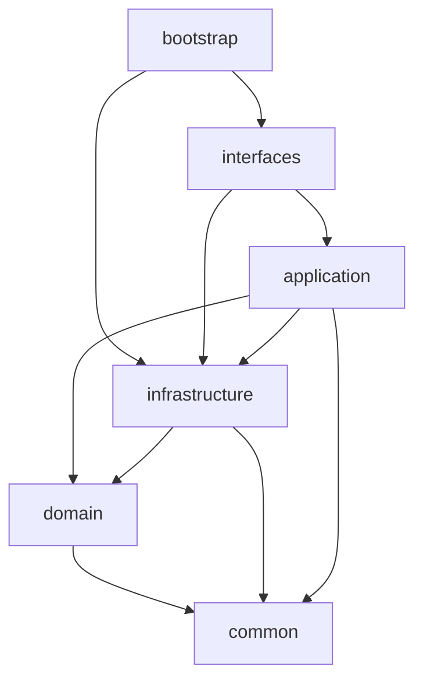
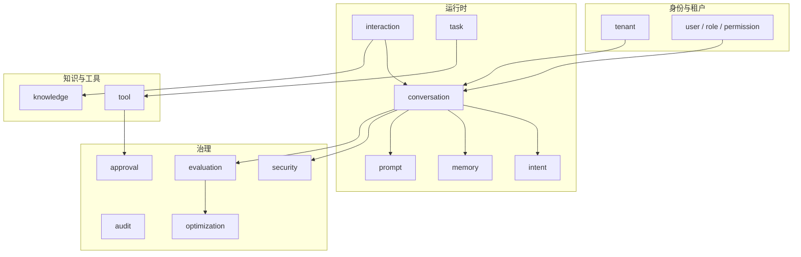
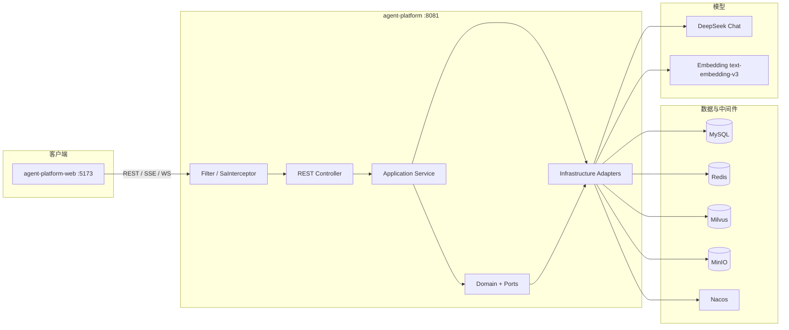
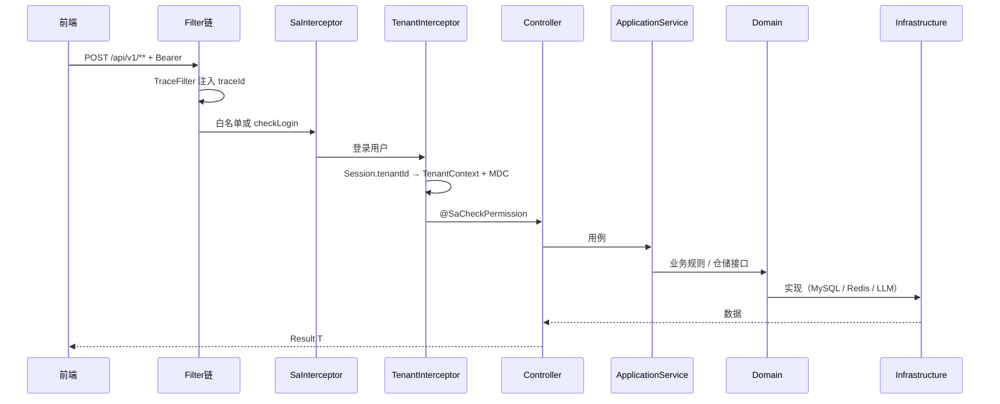
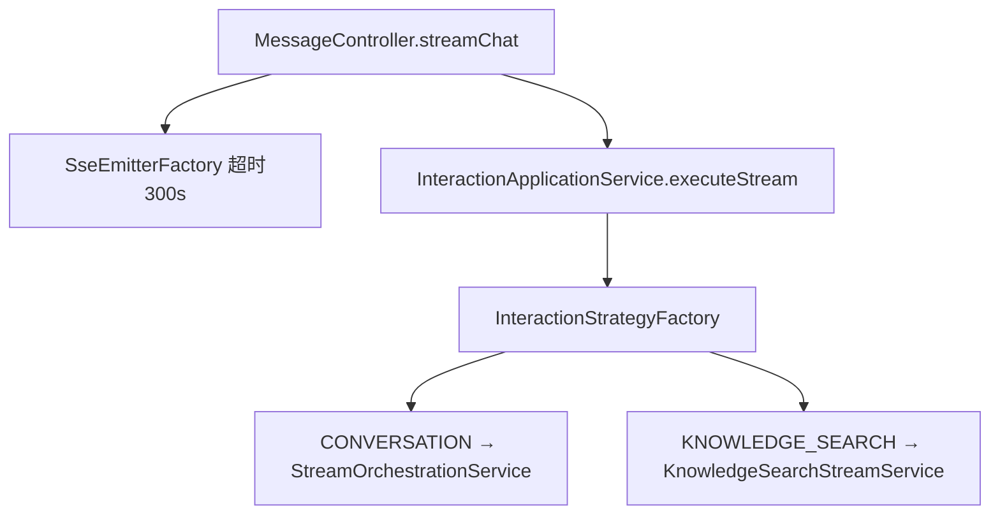
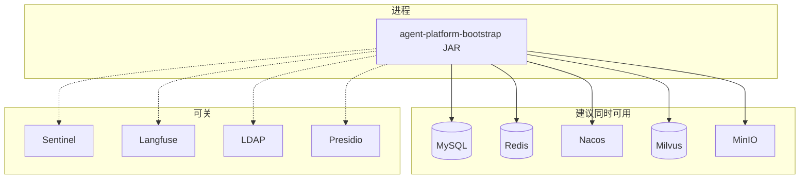

# 后端整体设计与架构

> 仓库：`agent-platform`  
> 包名：`com.example.agent`  
> 构建：Maven 多模块，JDK 17，Spring Boot 3.3.7  
> 默认端口：**8081**（`application-dev.yml`）  
> 配套：[02-功能全景.md](02-功能全景.md) · [03-数据模型.md](03-数据模型.md) · [README.md](README.md)

---

## 1. 系统定位

Agent Platform 后端是面向企业内部的 **AI Agent 运行时与治理平台**。同一套服务同时承担：

- **运行时**：多租户会话、LLM 流式输出、可选 RAG 知识检索
- **治理**：RBAC、提示词版本、工具注册、高风险审批、安全围栏
- **闭环**：审计、Trace/Metrics、评测跑批、BadCase 工单

前端同仓工程 `agent-platform/agent-platform-web`（开发端口默认 5173）通过 REST + SSE + WebSocket 接入；后端不负责页面渲染。

核心价值主张：

| 主张 | 含义 |
|------|------|
| 多租户 SaaS | 租户隔离、RBAC、配额与审计 |
| Agent 运行时 | 会话记忆 + ChatClient 流式 + 可选混合检索 |
| 企业可控 | 提示词版本、工具注册、审批、围栏 |
| 可观测可优化 | Trace / Prometheus / Langfuse / LLM-as-Judge / 工单 |

当前产品化 Agent 聚合（`t_agent_config`）尚未落地，会话创建时 `agentId` 使用常量默认值。对话主路径是「ChatClient 直调 DeepSeek」，任务路径是「LLM 产出 DAG + 拓扑执行」。

---

## 2. 设计原则

| 原则 | 含义 | 落地方式 |
|------|------|----------|
| **领域为中心** | 业务规则不进 Controller | `interfaces → application → domain ← infrastructure`；禁止 Controller 直接注入 Repository |
| **端口与适配器** | Domain 不依赖 Milvus / MCP / LLM SDK | 知识检索、认证等以接口定义在 domain，实现放 infrastructure |
| **快路径优先** | LLM 贵且慢，能短路就短路 | 意图三层链、Sentinel、Redis 缓存 |
| **Fail-open（旁路）** | 观测/审计失败不得拖垮主业务 | Langfuse、审计、部分过滤器异常吞掉并记日志 |
| **配置外置** | 运行参数不写死在代码 | Nacos DataId：调度、RAG、模型、安全、会话、Sentinel 规则 |
| **统一响应** | 前端只认一种信封 | `Result<T>`（code / message / data / timestamp） |
| **逻辑删除 + 租户字段** | 数据可恢复、可隔离 | MyBatis-Plus `deleted`；业务表普遍带 `tenant_id` |

强制依赖方向（`CLAUDE.md`）：

```
interfaces → application → domain ← infrastructure
Application 层禁止 import interfaces
```

实际偏离见第 3.2 节，文档按源码如实描述。

---

## 3. Maven 模块与分层架构

### 3.1 六模块职责

父 POM：`agent-platform/pom.xml`，`packaging=pom`。

| 模块 | artifactId | 职责 | 关键内容 |
|------|------------|------|----------|
| **common** | `agent-platform-common` | 共享内核 | `Result`、异常、`BizAssert`、`IdGenerator`、`ProjectConstants`、Redisson 锁封装 |
| **domain** | `agent-platform-domain` | 限界上下文、聚合、仓储接口、领域服务、端口 | tenant / conversation / knowledge / tool / security 等 |
| **application** | `agent-platform-application` | 用例编排、DTO、责任链、策略、管线 | 对话编排、RAG 管线、意图链、交互策略工厂 |
| **infrastructure** | `agent-platform-infrastructure` | 适配器实现 | MyBatis PO/Mapper、Milvus、MinIO、MCP、Sa-Token 配置、SSE、Nacos |
| **interfaces** | `agent-platform-interfaces` | HTTP 适配 | 22 个 REST Controller、Request DTO、Knife4j、全局异常 |
| **bootstrap** | `agent-platform-bootstrap` | 可执行入口 | `AgentPlatformApplication`、YAML、Actuator |

启动类：`com.example.agent.AgentPlatformApplication`，`@EnableAsync` + `@EnableScheduling`，扫描 `com.example.agent`。

### 3.2 依赖方向（实际）



理想六边形是 `application` 只依赖 `domain`。源码中 **application 依赖了 infrastructure**（TenantContext、SSE、Redis、Nacos 配置），domain 也引用了 Sa-Token（`StpInterfaceImpl`）。这是分层 DDD + 部分六边形，不是严格整洁架构。

网关不是独立 Spring Cloud Gateway，而是嵌入式 `SaInterceptor` + Filter。

### 3.3 限界上下文地图



---

## 4. 运行时架构



外部服务（dev 默认）：

| 服务 | 默认 | 用途 |
|------|------|------|
| MySQL | `localhost:3306` / 库 `agent_platform_dev` | 业务主库 |
| Redis | `localhost:6379` | Sa-Token 会话、短期记忆、意图缓存、RefreshToken、工具缓存 |
| Milvus | `localhost:19530` / db `agent_platform_dev` | RAG 向量 ANN |
| MinIO | 配置项 `minio.endpoint`，bucket `knowledge-docs` | 知识库原文件 |
| Nacos | `localhost:8848`，`NACOS_ENABLED` 默认 true | 配置中心 + 服务发现 |
| Sentinel | `SENTINEL_ENABLED` 默认 **false** | 限流熔断，规则可落 Nacos |
| DeepSeek | `spring.ai.deepseek` | Chat 流式 |
| Embedding | `spring.ai.openai` 兼容端点 | `text-embedding-v3` |
| Langfuse | 默认关闭 | LLM 追踪（HTTP Ingestion，无 Java SDK） |
| LDAP | 默认关闭 | 企业登录端口；不可用时降级本地 |
| Presidio | 默认关闭 | PII 增强，失败回退正则 |

密钥应通过环境变量覆盖：`DEEPSEEK_API_KEY`、`EMBEDDING_API_KEY`、`MYSQL_PASSWORD`、`REDIS_PASSWORD`、`MINIO_*`、`LANGFUSE_*`。YAML 中仍有本地开发明文默认值，不可带入生产。

Nacos DataId（配置治理）：

- `agent-platform-scheduler.json`
- `agent-platform-rag.json`
- `agent-platform-ai-model.json`
- `agent-platform-security.json`
- `agent-platform-session.json`
- Sentinel：`agent-platform-flow-rules.json` / `-degrade-rules.json` / `-system-rules.json`

---

## 5. 技术选型与原因

### 5.1 选型对照

| 技术 | 版本 | 为什么选 | 明确不选 / 已放弃 |
|------|------|----------|-------------------|
| **JDK 17** | 17 | 运行环境约束 | 不升 Boot 到 3.5.x（需要更高 JDK） |
| **Spring Boot** | 3.3.7 | Web / Actuator / 校验；对齐 Spring Cloud 2023.0.x | — |
| **Spring Cloud Alibaba** | 2023.0.3.2 | Nacos 配置/发现、Sentinel | 不用独立 Gateway |
| **Spring AI** | 1.1.7 | DeepSeek Chat、OpenAI 兼容 Embedding、MCP Client、RAG 抽象 | 不自研 Chat 协议栈 |
| **Spring AI Alibaba** | 1.1.2.0 | `spring-ai-alibaba-agent-framework` | 不含自建 ChatModel |
| **MySQL 8** | Connector 8.0.33 | 事务、JSON 字段、全文检索够用 | 禁止 9.x；不用 ES 做全文 |
| **MyBatis-Plus** | 3.5.9 | CRUD、软删、分页 | 不用 JPA（SQL 可控、团队习惯） |
| **手工 SQL 迁移** | V1.0.0–V1.7.0 | 环境可控、避免 Flyway 与手工库冲突 | **已移除 Flyway/Liquibase** |
| **Milvus** | SDK 2.6.9 | 向量 ANN，与 RAG 场景匹配 | 不用 pgvector（已选独立向量库） |
| **Redisson** | 3.37.0 | 分布式锁、会话相关结构 | dev 排除自动配置，避免 Redis 未起阻塞启动 |
| **Sa-Token** | 1.39.0 | 注解鉴权、Session、Refresh，比 Security Filter 链轻 | **不用 Spring Security 全套**；仅用 `spring-security-crypto` 做 BCrypt |
| **Hutool** | 5.8.32 | WordTree 敏感词、工具类 | — |
| **Apache Tika** | 2.9.2 | PDF/DOCX 等解析 | 不按格式各写一套 Parser |
| **MinIO** | 8.5.10 | S3 兼容对象存储，知识库原文件 | 文件不进 MySQL |
| **Micrometer** | 1.13.8 | Prometheus 指标 | Grafana Dashboard 尚未交付 |
| **Knife4j** | 4.5.0 | 中文增强 Swagger UI | — |
| **Spring StateMachine** | 4.0.0 | 对话状态预留 | **仅有 Config，未真正驱动** |
| **Sentinel** | SCA BOM | 限流熔断，规则可持久化到 Nacos | 默认关闭，避免本地无 Dashboard 干扰 |

### 5.2 关键简化（方案级，不算缺口）

| 原方案 | 落地简化 | 原因 |
|--------|----------|------|
| 独立 Spring Cloud Gateway | 嵌入式 SaInterceptor | 单体阶段减少运维面 |
| MCP 服务发现 | DB 轮询 + 心跳 | 工具数量有限，先可运营 |
| Elasticsearch 全文 | MySQL 全文索引 | 少一套集群 |
| 上传后自动解析 | 手动触发 parse + 异步任务中心 | 避免大文件堵住上传线程 |
| Langfuse Java SDK | HTTP Ingestion API | 降依赖、版本更稳 |

---

## 6. 请求处理全链路

### 6.1 同步 REST



横切顺序（概念）：

1. `TraceFilter`：traceId / spanId / requestId
2. CORS
3. Sa-Token：白名单（login、refresh、register、Swagger、health、`/ws/**`、OPTIONS）其余需登录；`/api/v1/admin/**` 需 ADMIN
4. `TenantInterceptor`：租户上下文
5. Controller 方法级 `@SaCheckPermission`
6. 全局异常 → `Result.fail`

租户 SQL 拦截器 `TenantSqlInterceptor` **已写未注册**，隔离目前靠手写 SQL + `TenantPermissionValidator` 防跨租户。

### 6.2 流式 SSE

入口：`POST /api/v1/conversations/messages/stream`，`TEXT_EVENT_STREAM`。



`SseEmitterFactory` 设置 `X-Accel-Buffering: no`，避免反向代理缓冲导致首 token 延迟。心跳间隔来自 Nacos `SessionConfig`。事件名：`thinking` / `token` / `done` / `ping`（以及预留的 `tool_call` / `tool_result` / `error`）。

---

## 7. API 风格

- 前缀：`/api/v1`
- 风格：**POST + 动词路径** 为主（`/list`、`/get`、`/create`），不是纯 REST 资源动词
- 统一信封：`Result<T>`
- 分页：MyBatis-Plus，前端使用 `records`；页码 **0-based**
- 文档：`/doc.html`（Knife4j）、`/swagger-ui.html`、`/v3/api-docs`
- 观测：`/actuator/health|info|prometheus|metrics|env`
- WebSocket：`/ws/conversation`（握手校验 Bearer）

22 个 REST Controller 清单见 [04-前后端交互.md](04-前后端交互.md)。

---

## 8. 部署与启动依赖



开发要点：

- Profile 默认 `dev`，端口 **8081**（8080 常被本机其他进程占用）
- `NACOS_ENABLED` 默认 true；本地无 Nacos 时需关闭或准备好 DataId
- Redis 未启动时，dev 已排除 Redisson 自动配置与 Redis 健康检查，但 Sa-Token / 短期记忆仍依赖 Redis
- SQL 在 `docs/database/` 按版本手工执行，无自动迁移
- 测试：目前几乎只有上下文级测试，自动化覆盖不足

生产：`application-prod.yml` 使用库 `agent_platform`、更大 Hikari、日志 `/var/log/agent-platform`、Sa-Token 独立 Redis DB。

---

## 9. 与前端的边界

后端只暴露能力，不假设页面结构：

| 后端提供 | 前端消费 |
|----------|----------|
| Sa-Token Bearer + Refresh | `apiClient` 注入 Header，401 清态 |
| SSE 命名事件 | `useSSE`：fetch + ReadableStream |
| WebSocket `/ws/conversation` | `useWebSocket` 心跳与重连 |
| `resource:action` 权限码 | 路由 / 菜单 / 按钮三层校验 |
| 交互模式枚举 | 聊天页 `CONVERSATION` / `KNOWLEDGE_SEARCH` |

详细协议见 [04-前后端交互.md](04-前后端交互.md)。功能级设计见 [02-功能全景.md](02-功能全景.md)。
