# 后端功能设计

> 本文是后端「分」文档：按限界上下文展开。  
> 每章统一四段：**设计思路 → 技术选型原因 → 实现思路 → 流程图**。  
> 文末汇总「设计意图 vs 落地」，避免把未接线能力写成已闭环。  
> 配套：[01-后端架构.md](01-后端架构.md) · [03-数据模型.md](03-数据模型.md)

---

## 1. 多租户与 RBAC

### 设计思路

企业 Agent 平台按租户隔离数据与配置。身份模型采用经典 RBAC：用户属于租户，角色绑定权限码，权限码格式 `resource:action`。业务表普遍带 `tenant_id`，接口层用 Session 中的租户 ID 约束查询，防止跨租户读写。

不把租户做成独立微服务：当前是单体多租户，隔离在应用层完成。

### 技术选型原因

| 选择 | 原因 |
|------|------|
| 权限码字符串而非 ACL 树 | 与 Sa-Token `@SaCheckPermission` 直接对齐，前后端同一套编码 |
| 角色-权限、用户-角色两张关联表 | 变更角色即可批量改权，不必改每个用户 |
| `tenant_id` 逻辑隔离，无 DB 物理外键 | 便于分库演进、避免级联删除意外 |
| `TenantInterceptor` + `TenantContext` | 请求级 ThreadLocal，下游不必层层传参 |

### 实现思路

- 实体：`Tenant`、`User`、`Role`、`Permission`（domain 包根）
- 应用服务：`TenantApplicationService`、`UserApplicationService`、`RoleApplicationService`、`PermissionApplicationService`
- 接口：`TenantController` `/api/v1/tenants`、`UserController`、`RoleController`、`PermissionController`
- `StpInterfaceImpl` 从 DB 加载当前用户的角色码与权限码，供 Sa-Token 注解使用
- `TenantPermissionValidator` 校验资源归属
- `TenantSqlInterceptor` 已实现但**未注册到 MyBatis**，当前不能自动拼 `tenant_id` 条件

### 流程图

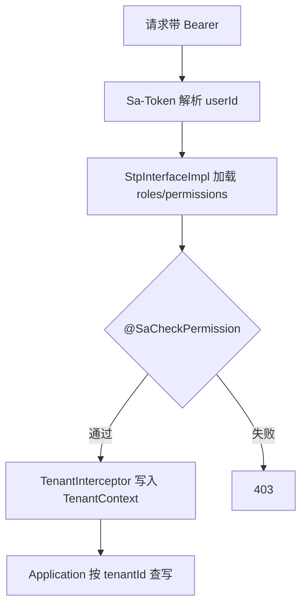

---

## 2. 认证登录

### 设计思路

认证与鉴权分离：认证解决「你是谁」，鉴权解决「你能做什么」。登录成功后签发 AccessToken（短）+ RefreshToken（长），前端每次请求带 Bearer。支持本地账号，并预留企业目录（LDAP）端口，便于后续接 SSO。

### 技术选型原因

| 选择 | 原因 |
|------|------|
| Sa-Token 而非 Spring Security | 注解式、Session 可落 Redis、与单体嵌入式拦截更贴合；避免完整 Filter 链 |
| Token 风格 `random-64` | 服务端 Session，不在客户端解析 JWT 载荷，吊销即时生效 |
| BCrypt（spring-security-crypto） | 只引入密码哈希，不引入整套 Security |
| `AuthenticationProvider` 端口 | 本地 / LDAP 可替换，领域不绑死一种 IdP |
| Refresh 存 Redis 并轮换 | 降低长期 Token 泄露窗口 |

不选 JWT 自解析：权限变更后旧 Token 在过期前仍有效，企业场景难以及时吊销。

### 实现思路

- `AuthController`：`/login`、`/refresh`、`/logout`、`/me`（GET/POST）
- 登录：`provider` 为空或 LOCAL 走 `UserService.authenticate`（BCrypt）；否则 `AuthProviderFactory` → LDAP
- `StpUtil.login(userId)`，Session 写入 `tenantId`、`username`
- AccessToken：`Authorization: Bearer`，timeout 3600s，active-timeout 1800s（dev）
- RefreshToken：Redis `refresh:{userId}`，TTL 7 天，刷新即轮换
- LDAP：`LdapAuthenticationProvider`；服务不可用时**降级本地**。SSO/OIDC **无实现类**
- 白名单：login、refresh、`users/register`、Swagger、health/info/prometheus、`/ws/**`、OPTIONS

### 流程图

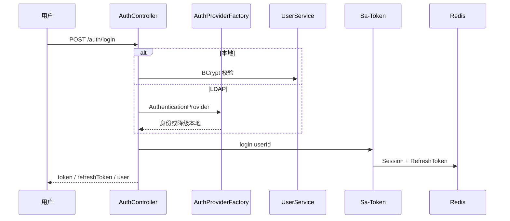

---

## 3. 会话与消息

### 设计思路

对话是 Agent 运行时的一等公民。会话绑定租户、用户与 `agentId`；消息按 USER / ASSISTANT / SYSTEM / TOOL 落库。历史分页与「加载更早」分开，避免一次拉全量。消息可点赞点踩，作为优化闭环的输入事件。

Agent 配置表存在但无领域模型，创建会话时 `agentId` 可空，默认 `ProjectConstants.Conversation.DEFAULT_AGENT_ID`。

### 技术选型原因

| 选择 | 原因 |
|------|------|
| 会话与消息分表 | 会话列表只扫轻量字段；消息 MEDIUMTEXT 独立存储 |
| 业务 ID（conversation_id / message_id）与自增主键并存 | 对外暴露 UUID 风格 ID，避免泄露自增 |
| 反馈写在消息行上 | 简单、可与 `MessageFeedbackEvent` 解耦出工单 |

### 实现思路

- `ConversationController`：create / list / get / update-title / transition-status / delete
- `MessageController`：send（非流式落库）/ stream / list / before / feedback
- `ConversationApplicationService`、`MessageApplicationService`
- 领域：`Conversation`、`Message`、`ConversationDomainService`
- 反馈：更新 `t_message.feedback`，发布 `MessageFeedbackEvent` 供优化模块消费
- 状态：ACTIVE / CLOSED / ARCHIVED；Spring StateMachine **仅有 Config，未驱动流转**

### 流程图

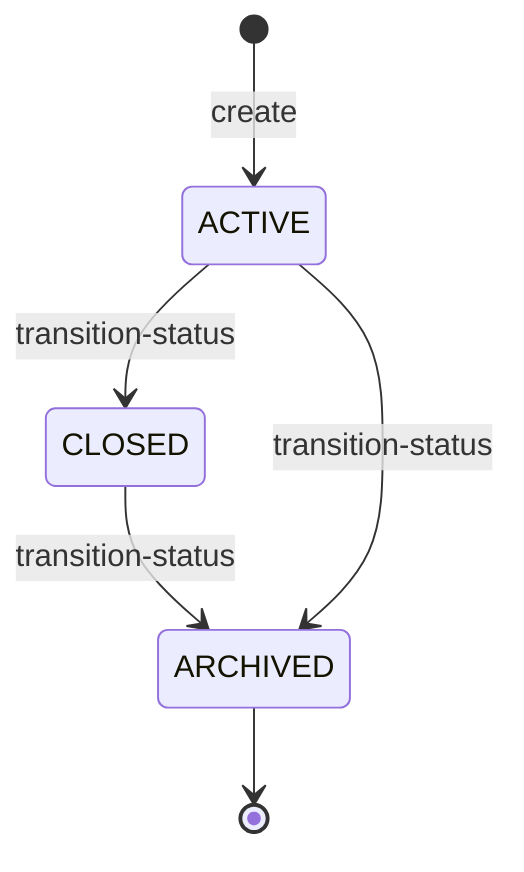

---

## 4. 流式对话编排

### 设计思路

LLM 首 token 延迟敏感，必须走 SSE 而非等完整 JSON。编排服务负责：落用户消息、拼上下文、推 thinking/token、落助手消息、旁路观测。心跳防止代理断开空闲连接。

### 技术选型原因

| 选择 | 原因 |
|------|------|
| Spring `SseEmitter` | 与 MVC 一体，可设超时与完成回调 |
| `ChatClient.stream()`（Spring AI） | 统一流式 API，对接 DeepSeek |
| 超时 300s | 长回答与思考过程需要分钟级窗口 |
| `X-Accel-Buffering: no` | Nginx 默认缓冲会毁掉流式体验 |
| 事件命名而非纯 data | 前端可区分 token / thinking / done / 错误 |

### 实现思路

入口仍是 `MessageController.streamChat`，真正编排在 `StreamOrchestrationService`（CONVERSATION 模式）：

1. 保存用户消息  
2. Redis 短期记忆  
3. 意图识别（**目前只打日志，不消费**）  
4. 拼 Prompt（历史 + 用户输入；**未用已发布提示词模板、未注入长期记忆、未过安全围栏**）  
5. 心跳 + thinking 事件  
6. `ChatClient.stream()` 推 token  
7. 保存助手消息 + Langfuse + 异步抽取长期记忆  

基础设施：`SseEmitterFactory`、`SseEventFactory`。

### 流程图

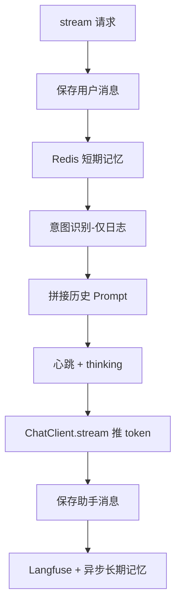

---

## 5. 多模式交互（P7）

### 设计思路

同一流式入口按 `mode` 路由到不同策略，避免为每种交互复制一套 Controller。当前产品需要两种主路径：纯对话 vs 知识检索增强生成。后续任务执行、分析推理、审批交互应作为新策略注册，而不是改 Controller。

### 技术选型原因

| 选择 | 原因 |
|------|------|
| 策略模式 + 工厂 | 新增模式只加 `InteractionStrategy` 实现 |
| 流式仍走 MessageController | 前端聊天框只对接一个 SSE URL |
| 同步走 `InteractionController` | 管理台「交互测试」需要一次性 JSON 结果 |

### 实现思路

- 领域：`InteractionMode` 目前仅 `CONVERSATION`、`KNOWLEDGE_SEARCH`
- `InteractionApplicationService.executeStream` → `InteractionStrategyFactory`
- 策略：`ConversationInteractionStrategy`、`KnowledgeSearchInteractionStrategy`
- 同步：`POST /api/v1/interactions/execute`；模式列表：`GET /api/v1/interactions/modes`
- 知识检索流式：`KnowledgeSearchStreamService`（见第 10 章）

未实现：任务执行 / 分析推理 / 安全审批交互模式、模式市场与租户配额。

### 流程图

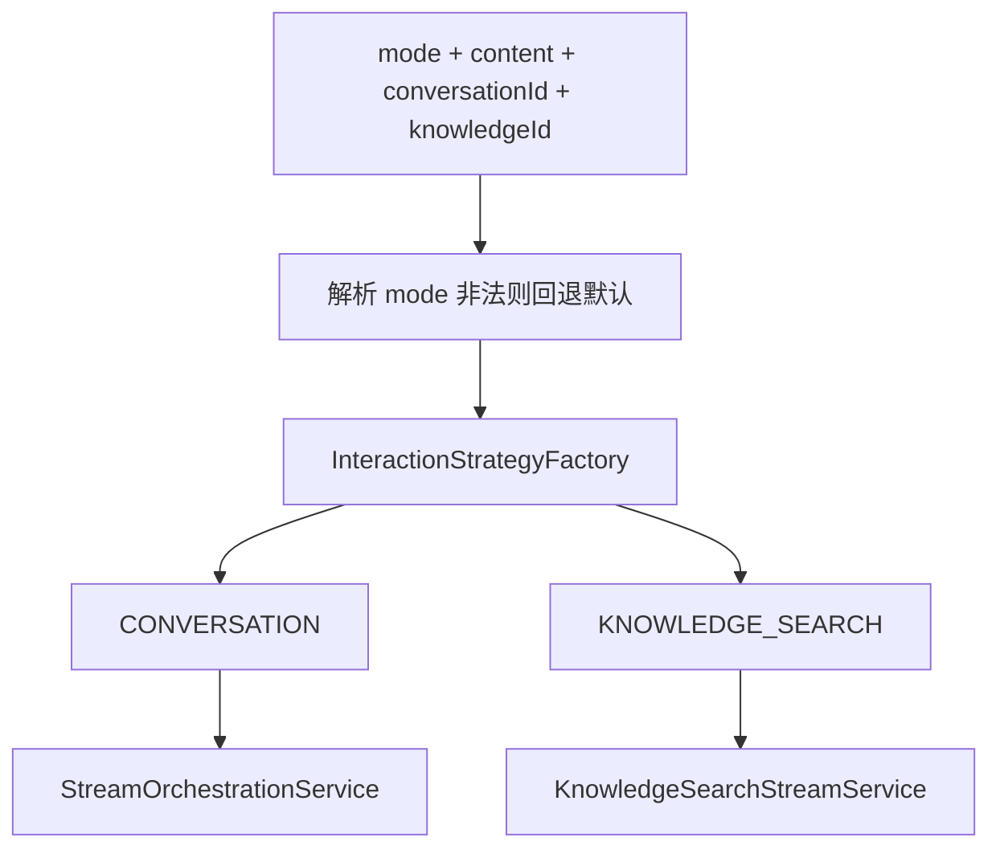

---

## 6. 意图识别

### 设计思路

意图用于把闲聊、FAQ、任务、多步流程分开，以便后续选 Prompt、选工具或走 DAG。识别必须便宜：规则命中则不再调 LLM。

### 技术选型原因

| 选择 | 原因 |
|------|------|
| 责任链：规则 → 缓存 → LLM | 快路径优先，控制 Token 成本 |
| Redis 缓存识别结果 | 相同问法短时间内不重复打模型 |
| 意图定义落库（patterns / examples） | 运营可配，不全写死在代码 |

### 实现思路

- `IntentController`：CRUD、启停、单条/批量测试
- `IntentRecognitionChain`：`RuleRecognizer` → `CacheRecognizer` → `LLMRecognizer`
- 领域：`Intent`（category：FAQ / TASK / CHITCHAT / MULTI_STEP，risk_level）
- **主对话编排只调用链并打日志，结果未用于选 Prompt / 选工具 / 切模式**

### 流程图

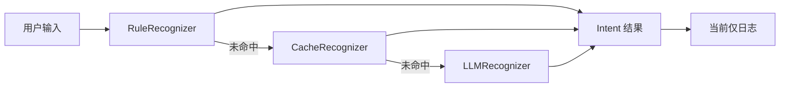

---

## 7. 记忆

### 设计思路

短期记忆服务「这一轮对话连贯」；长期记忆服务「这个用户是谁、偏好什么」。短期必须低延迟，适合 Redis；长期要可查询、可过期，适合 MySQL。抽取应异步，避免拖慢 SSE。

### 技术选型原因

| 选择 | 原因 |
|------|------|
| Redis List/窗口做短期 | 与会话 TTL 一致，重启可丢 |
| `t_long_term_memory` | 按 user + key 存事实/偏好/摘要 |
| 异步抽取 | 不阻塞 token 流 |

### 实现思路

- `SessionMemoryService`：读写 Redis 近期消息
- `LongTermMemoryService`：对话结束后异步写入
- **长期记忆当前只写不读，未注入 Prompt**
- 对话 Redis 检查点 / 断点续传 **未开工**

### 流程图

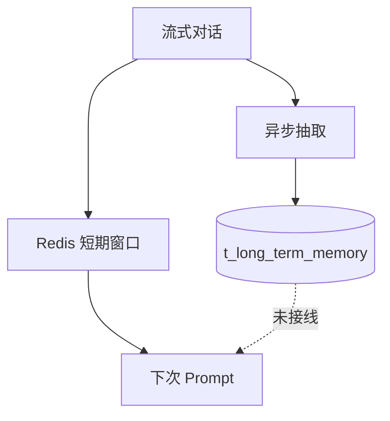

---

## 8. 提示词管理

### 设计思路

提示词是企业可控的核心资产：要有草稿、发布、回滚、版本 diff、变量渲染。运行时应使用**已发布**版本，而不是编辑中的草稿。支持按租户隔离模板。

### 技术选型原因

| 选择 | 原因 |
|------|------|
| 模板表 + 版本表 | 发布不覆盖历史，可 rollback |
| Resolver 链渲染变量 | 系统变量、租户变量、运行时变量分层解析 |
| 预览/diff API | 运营可在上线前核对 |

### 实现思路

- `PromptController`：create/list/get/update/delete/preview/publish/rollback/archive/versions/diff/render
- `PromptApplicationService`、`PromptRenderService` + Resolver 链
- 领域：`PromptTemplate`、`PromptTemplateVersion`、`PromptDomainService`
- **已发布模板未注入 StreamOrchestrationService；Redis 缓存读路径未完成**

### 流程图

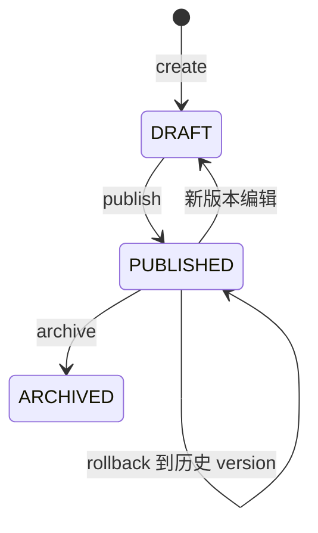

---

## 9. 任务规划与 DAG

### 设计思路

复杂目标拆成有依赖的步骤图，可并行执行无依赖节点。规划交给 LLM，执行交给确定性 Handler（查订单、发邮件、计算等）。高风险步骤应走审批（设计上），超时由扫描器兜底。通用异步任务中心（`t_async_task`）承接文档解析等耗时作业，与对话 DAG 分开。

### 技术选型原因

| 选择 | 原因 |
|------|------|
| LLM 出 DAG + 自研执行器 | 不引入重量级工作流引擎（Camunda 等） |
| 拓扑并行 | 缩短多步任务墙钟时间 |
| Handler 注册表 | 新动作只加 Handler，不改执行器 |
| 独立 `t_async_task` | 解析/导出与对话 DAG 生命周期不同 |

### 实现思路

- `TaskController`：plan / execute / status / plan/get / cancel / handlers
- `TaskPlanningService`、`DagExecutionService`、`TaskCenterService`、`TaskTimeoutScanner`
- 领域：`TaskExecution`、`TaskStepExecution`、`AsyncTask`
- 示例 Handler：`RetrieveOrdersHandler`、`SendEmailHandler`、`CalculateSumHandler`（示例级，非生产级业务）
- **无独立 AsyncTask REST**；文档解析走任务中心内部提交
- 工具 `requireApproval` **未接入对话主路径**；审批可 resume/cancel DAG，但聊天流未挂工具

### 流程图

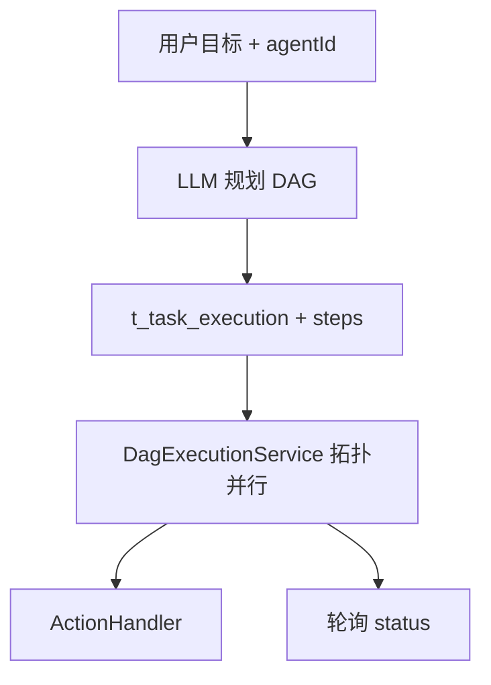

---

## 10. RAG 知识库

### 设计思路

企业知识不能只靠模型参数：文档入库 → 切片 → 向量化 → 检索 →（可选）精排 → 约束生成。元数据在 MySQL，向量在 Milvus，原文件在 MinIO。检索采用「向量 ANN + 词法全文」融合（RRF），降低单一通道漏召。精度配置按文档 > 知识库 > 策略预设 > 系统四级合并（代码有，对话检索未完整加载）。

上传与解析解耦：上传只落 MinIO 与 `PENDING_PARSE`，由运营触发 parse，经异步任务中心执行，避免 HTTP 超时。

### 技术选型原因

| 选择 | 原因 |
|------|------|
| Milvus | 专用向量库，ANN 性能与过滤能力匹配多租户 collection 规划 |
| MySQL 全文而非 ES | 少运维一套搜索集群，当前体量可接受 |
| Tika | 覆盖 PDF/Office 等，不必自研解析 |
| MinIO | 原文件与切片解耦，可预签名下载 |
| 多种切片策略 | 制度文档、FAQ、Markdown 结构不同 |
| RRF 融合 | 无需统一打分模型即可混合两路结果 |
| Reranker 可插拔 | NONE / CROSS_ENCODER / COLBERT / LLM；渐进增强 |

### 实现思路

**管理**

- `KnowledgeBaseController`、`DocumentController`、`FileManagementController`、`PrecisionController`、`KnowledgeSearchController`
- 管线：`DocumentPipelineOrchestrator` → 切片策略 → Embedding → Milvus
- 切片：多种 `ChunkStrategy`（部分参数仍硬编码）
- 异步：`DocumentParseTaskHandler` + `t_async_task`

**检索**

- `HybridSearchApplicationService`：Milvus ANN + MySQL BM25 + 加权 RRF
- `LLMReranker` / `RerankerRegistry`；**CrossEncoder 为 Stub；ColBERT 未做**
- 知识检索流式：命中则用「仅基于检索、引用来源、禁止臆造」的 RAG Prompt 再调 LLM；无命中给友好提示
- **KB 删除不清 Milvus**；四级精度 merge **对话检索未真正按 KB 加载**

### 流程图

文档入库：

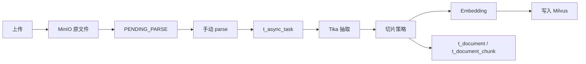

检索生成：

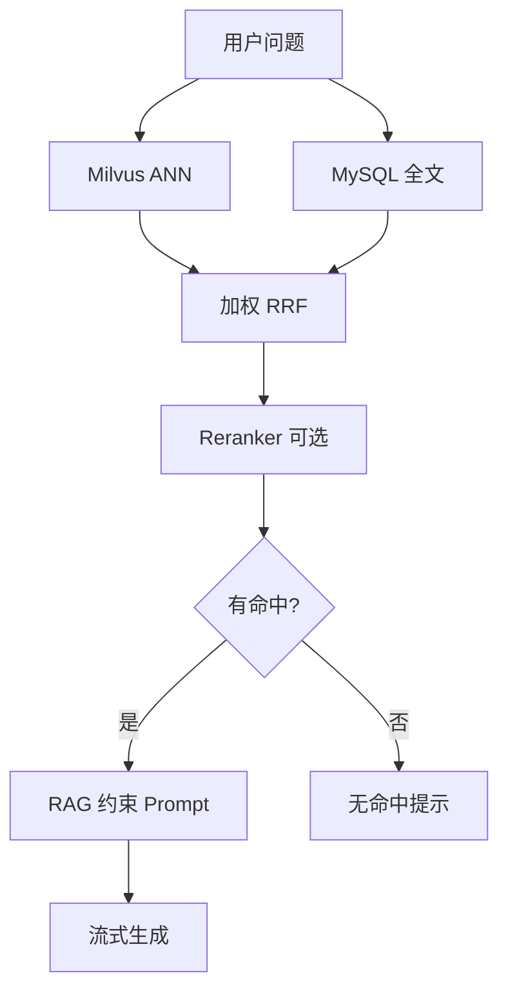

---

## 11. MCP 工具平台

### 设计思路

Agent 能力外延靠工具：HTTP API、MCP Server、内置函数。工具要注册、版本化、可回滚、可测试，调用要记日志。高风险工具用 `require_approval` 卡住执行（设计目标）。存活靠心跳，避免调用已死端点。

### 技术选型原因

| 选择 | 原因 |
|------|------|
| MCP Client（Spring AI） | 协议标准化，对接外部工具生态 |
| DB 注册 + 轮询而非服务发现 | 工具数量少，运营改一行即可 |
| 版本表 `t_tool_registry_version` | 与提示词一样可 rollback |
| `HttpToolAdapter` | 非 MCP 的存量 HTTP 接口也能接入 |

### 实现思路

- `ToolController`：create/list/get/update/toggle-status/test/invocations/versions/rollback
- `ToolApplicationService`、`ToolDomainService`
- 领域：`ToolRegistry`、`ToolInvocationLog`、`ToolRegistryVersion`
- 基础设施：`McpClientManager`、`HttpToolAdapter`、`McpHeartbeatDetector`、`ToolCacheManager`
- **工具调用未接入 StreamOrchestrationService**；SSE 的 `tool_call` / `tool_result` 事件前端已预留

### 流程图

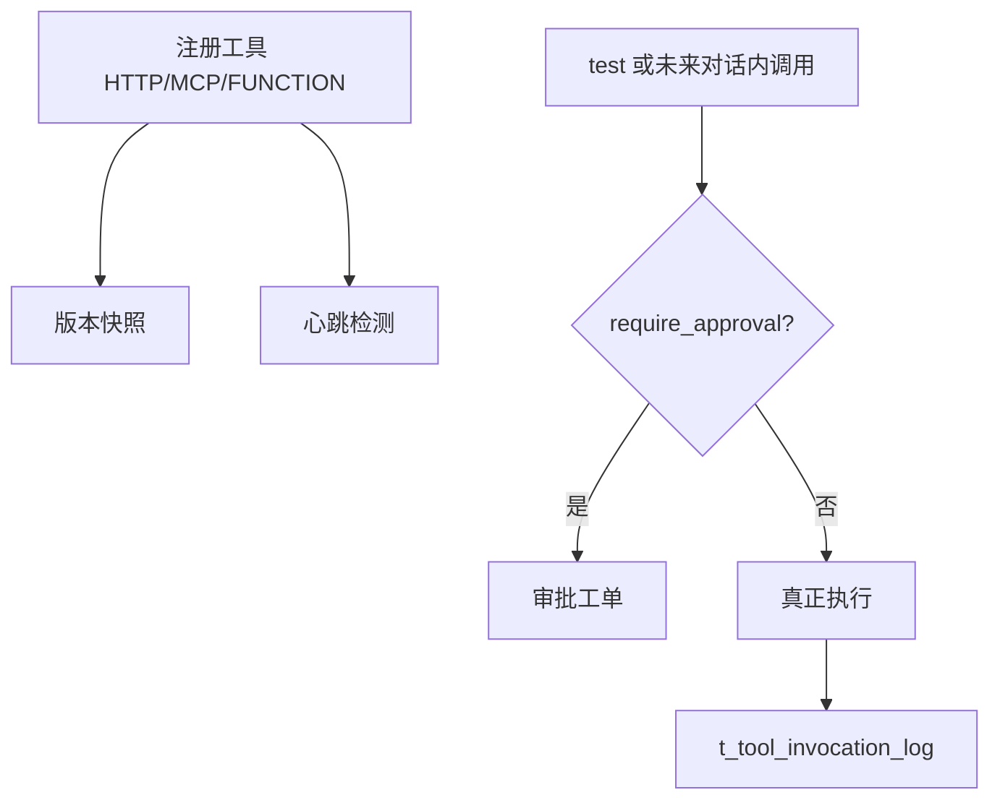

---

## 12. 安全围栏

### 设计思路

模型输入输出都是攻击面：提示注入、越狱、敏感词、超长刷 Token、PII 泄漏。围栏应做成可编排过滤器链，先挡输入，再对输出脱敏。命中要记安全事件，供审计与运营。

### 技术选型原因

| 选择 | 原因 |
|------|------|
| 责任链过滤器 | 可单独开关、排序清晰 |
| Hutool WordTree | 敏感词高性能多模式匹配 |
| 正则 PII + 可选 Presidio | 无 Python 服务时也能脱敏；有服务则增强 |
| 事件表而非只打日志 | 可在管理台检索 |

### 实现思路

- `SecurityFenceController`：敏感词 CRUD、事件列表
- 输入链：`InjectionFilter` → `JailbreakFilter` → `SensitiveWordFilter` → `LengthFilter`
- 输出：`PiiDesensitizer`（身份证/手机/邮箱/银行卡/固话/IP）
- 领域：`SensitiveWord`、`SecurityEvent`
- **过滤器链未挂到 stream 主链路**（P0 接线缺口）
- `@RateLimit` + `RateLimitAspect` 已写，**接口上基本未挂**
- Presidio 默认关闭，失败回退正则

### 流程图

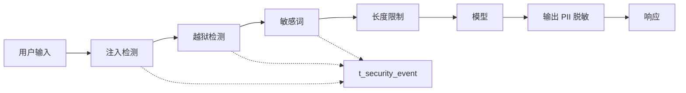

上图为**设计意图**。当前 stream 从输入直接到拼 Prompt，未经过该链。

---

## 13. 人机协同审批

### 设计思路

高风险工具（发邮件、改数据、外部转账等）不能模型说了算。应生成审批工单，推到 Web 或 IM，超时自动拒绝或取消 DAG。审批通过后恢复执行。

### 技术选型原因

| 选择 | 原因 |
|------|------|
| 独立 `t_approval_workflow` | 与工具调用、任务执行解耦，可在审批中心集中处理 |
| WebSocket 推卡片 | 聊天内实时出现，不必刷列表 |
| 超时 Job | 防止工单悬挂 |

### 实现思路

- `ApprovalController`：list/get/approve/reject/stats
- `ApprovalWorkflowApplicationService`、`ApprovalTimeoutJob`
- 领域：`ApprovalWorkflow`
- 审批可 resume/cancel DAG
- **主聊天流未挂工具调用，因此卡片推送闭环不完整**；前端审批页与卡片组件已按协议实现

### 流程图

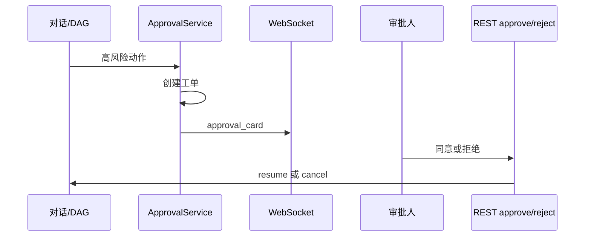

---

## 14. 效果评估与优化闭环

### 设计思路

上线后要能量化「答得好不好」：用数据集跑批（LLM-as-Judge 或规则），把踩反馈与低分样本变成优化工单，形成「发现 → 指派 → 修复 → 回归」闭环。

### 技术选型原因

| 选择 | 原因 |
|------|------|
| 数据集 + 条目 + 跑批记录 三表 | 可复现实验，不把结果写死在日志 |
| 工单与消息/会话关联 | 运营能跳回原对话 |
| 反馈事件驱动自动开单 | 减少人工捞 BadCase |

### 实现思路

- `EvaluationDatasetController`、`EvaluationRunController`、`OptimizationTicketController`
- `EvaluationDatasetService`、`EvaluationRunService`、`RetrievalPrecisionService`
- `OptimizationTicketService`、`BadCaseAutoTicketService`
- 领域：`EvaluationDataset`、`EvaluationDatasetItem`、`EvaluationRun`、`OptimizationTicket`
- 反馈统计：`/optimization-tickets/feedback/stats`（与前端对齐仍有文档级缺口 E2）

### 流程图

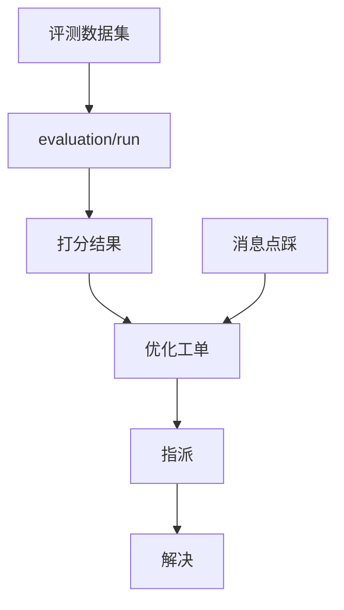

---

## 15. 可观测性与配置治理

### 设计思路

一次对话跨越 HTTP、LLM、向量库、对象存储，必须有 traceId 贯穿日志与指标。LLM 调用另送 Langfuse 便于看 Prompt。可变参数（调度间隔、RAG topK、模型名、会话超时、Sentinel 规则）进 Nacos，避免改代码发版。

### 技术选型原因

| 选择 | 原因 |
|------|------|
| Micrometer + Prometheus | 与 Spring Boot Actuator 原生集成 |
| 自研 `TraceFilter` 而非先上 OTel | 先打通 MDC；OTel 列为未实现 D2 |
| Langfuse HTTP | 不绑 SDK 版本 |
| Nacos 多 DataId | 按域刷新，改 RAG 不影响调度 |
| 审计 `@Auditable` + AOP | 写操作可追溯，失败 Fail-open |

### 实现思路

- `TraceFilter`、`AgentMetrics`、`LangfuseTraceService`、`AuditLogAspect` → `t_audit_log`
- Actuator：health / info / prometheus / metrics / env
- Nacos：scheduler / rag / ai-model / security / session；Sentinel 规则可选
- **未交付**：Grafana Dashboard、OTel、ELK、AlertManager、Span 层级建模、JVM 资源专题盘

### 流程图

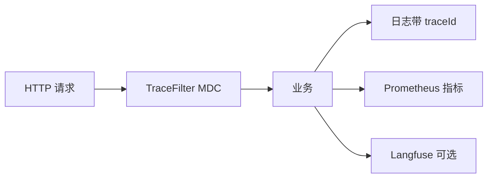

---

## 16. 设计意图 vs 落地

| 类别 | 代表项 | 状态 |
|------|--------|------|
| **未接线** | 围栏未进 stream；意图只打日志；长期记忆只写不读；提示词模板未进对话；工具/审批未进聊天；StateMachine 无驱动；TenantSqlInterceptor 未注册；KB 删除不清 Milvus | 代码在，主路径未用 |
| **Stub / 降级** | LDAP 降级本地；CrossEncoder 假精排；切片参数部分硬编码；`@RateLimit` 未挂接口 | 接口在，实现不完整 |
| **未开工** | SSO/OIDC；对话 Redis 检查点；P7 任务/分析/审批模式；ColBERT | 仅方案 |
| **表无代码** | `t_agent_config` | 孤立表 |
| **测试** | 几乎只有 1 个 Spring Boot 上下文测试 | 工程债 |
| **运维** | Grafana / OTel / ELK / Docker / K8s / Presidio 服务 | 未交付 |

方案级简化（不算缺口）：Gateway→Filter；MCP 发现→DB 轮询；ES→MySQL 全文；上传自动解析→手动触发。

下一篇：[03-数据模型.md](03-数据模型.md)
