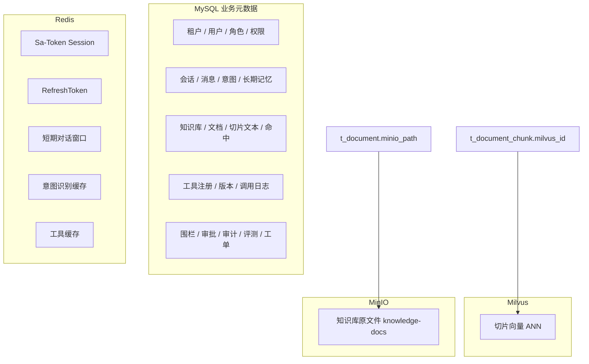
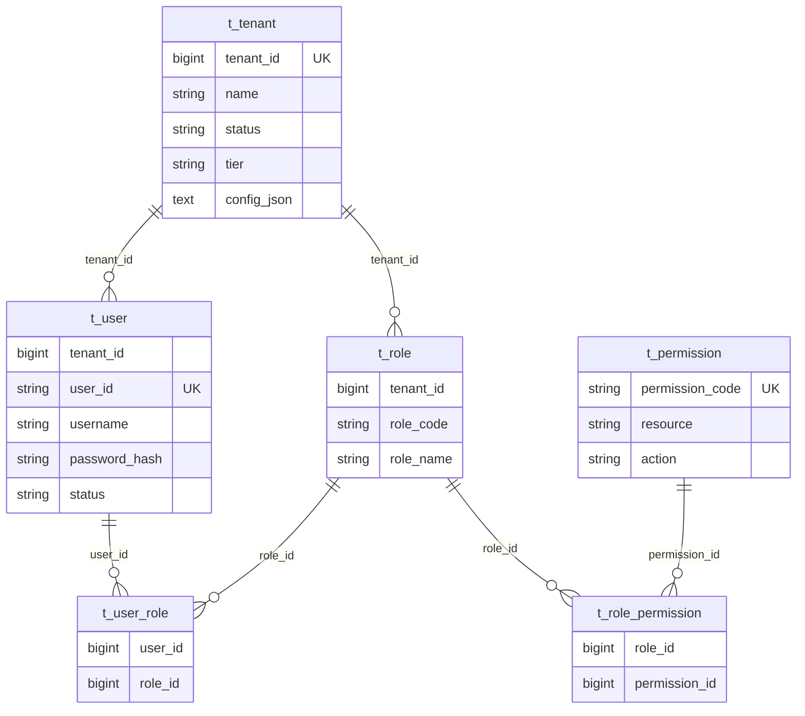
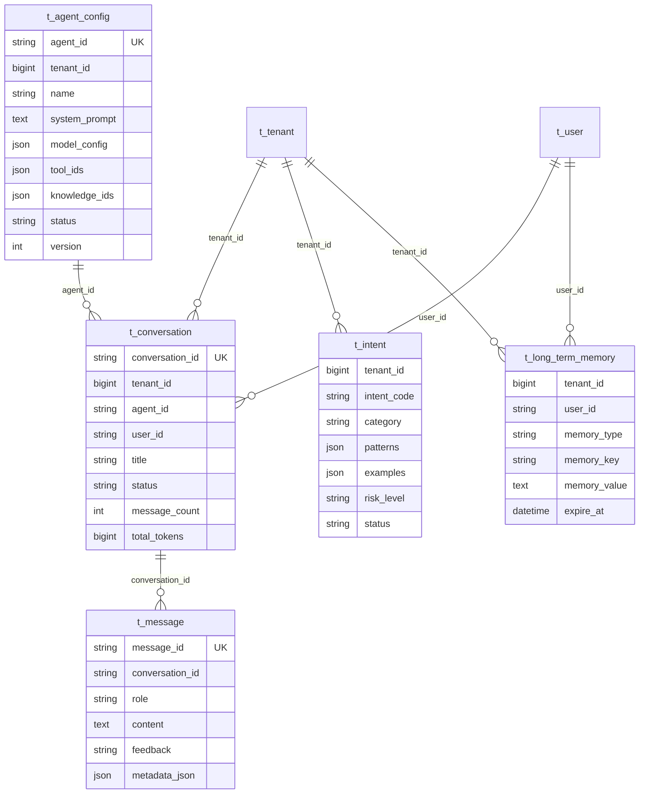
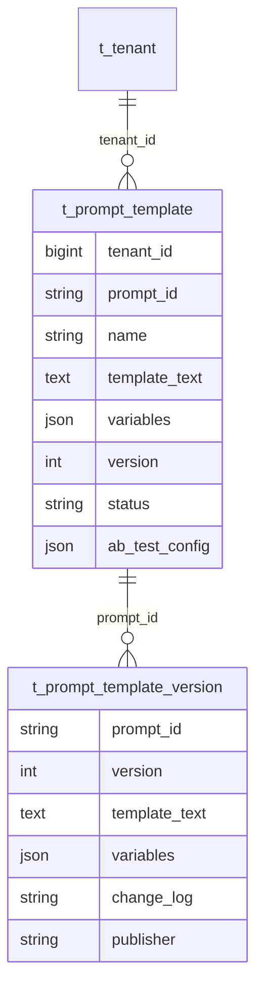
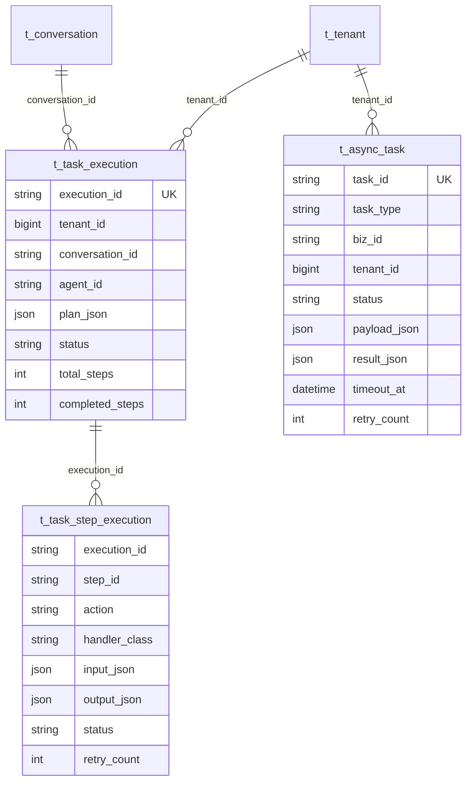
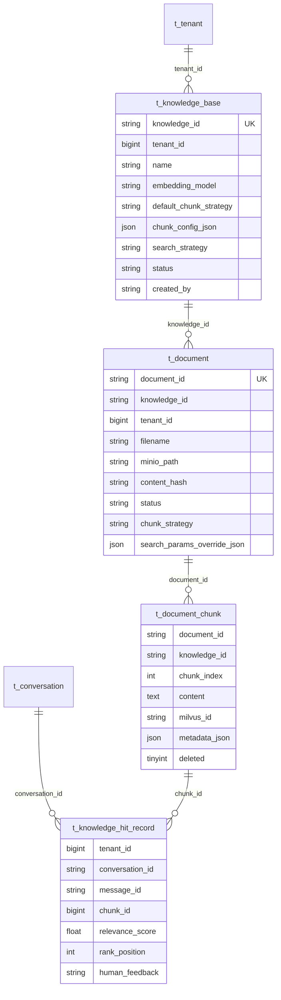
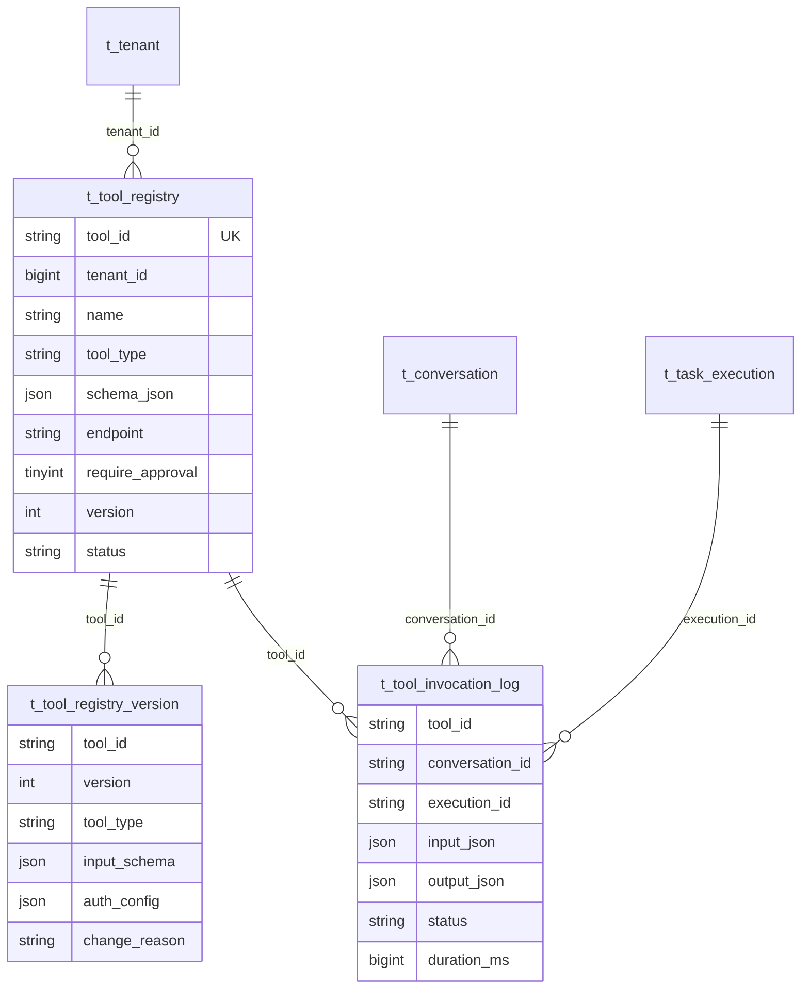
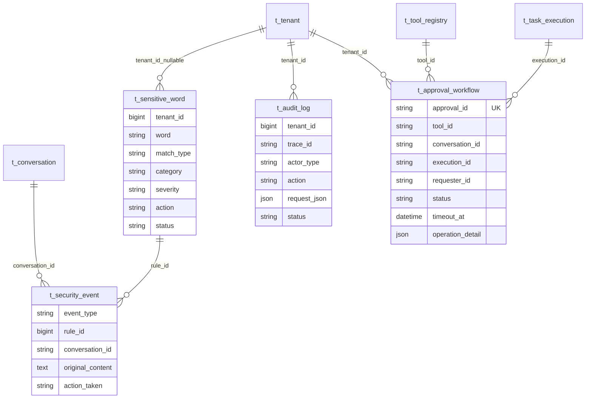
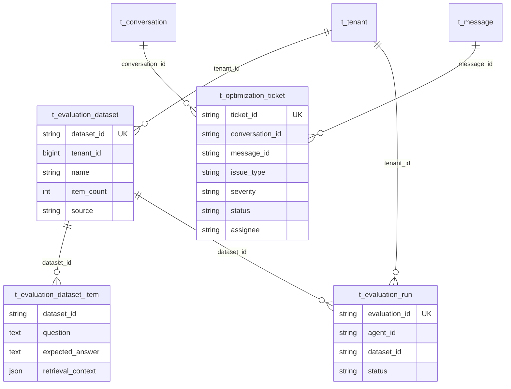
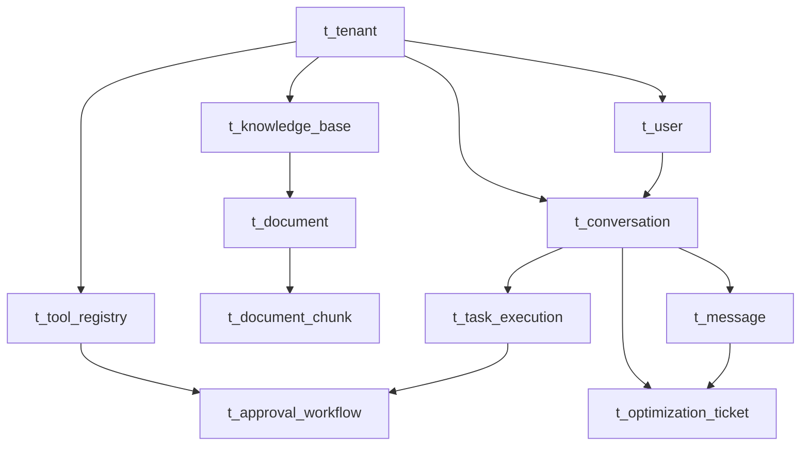

# 后端数据模型

> 存储分工 + 分域 ER。表结构来自 `agent-platform/docs/database/` V1.0.0–V1.7.0，需手工执行，无 Flyway。  
> **无物理外键**，下图均为逻辑关系。业务表普遍含 `tenant_id` + 逻辑删除 `deleted`。

配套：[01-后端架构.md](01-后端架构.md) · [02-功能全景.md](02-功能全景.md) · [`../database/`](../database/README.md)

---

## 1. 存储分工

| 存储 | 存什么 | 不存什么 |
|------|--------|----------|
| **MySQL** | 实体、状态机、权限、切片原文、命中与审计 | 向量、大文件二进制 |
| **Redis** | 会话 Token、短期记忆、缓存 | 作为唯一真相的业务实体 |
| **Milvus** | embedding 向量 + 过滤字段 | 完整文档 |
| **MinIO** | PDF/DOCX 等原件 | 业务关系 |

约定：

- 对外业务 ID（`conversation_id`、`message_id`、`knowledge_id` 等）与自增 `id` 并存。
- 隔离靠 `tenant_id` + 应用层校验；`TenantSqlInterceptor` 未注册，**不能假设 SQL 会自动带租户条件**。
- `t_sensitive_word.tenant_id` 可空，表示全局规则。

---

## 2. 迁移版本与表清单

| 版本 | 文件 | 增量 |
|------|------|------|
| V1.0.0 | `V1.0.0__baseline_schema.sql` | 13 张基线表 |
| V1.1.0 | `V1.1.0__extended_schema.sql` | 意图、记忆、版本、任务、文档、围栏、审批、评测等 |
| V1.2.0 | `V1.2.0__seed_admin_data.sql` | 管理员种子 |
| V1.2.1 | 业务 ID + 权限种子 | `intent_id` 等；完整 `resource:action` |
| V1.2.2 | 工具调用业务 ID | `invocation_id` |
| V1.3.0 | 切片策略与精度字段 | KB/文档检索配置 |
| V1.4.0 | 文件管理升级 | `created_by`、状态迁移、chunk.deleted |
| V1.5.0 | 工具版本表 | `t_tool_registry_version` |
| V1.6.0 | 异步任务中心 | `t_async_task` |
| V1.7.0 | 交互权限种子 | `interaction:execute` / `interaction:read` |

约 **31 张业务表**（含关联表）。孤立点：`t_agent_config` **有表无 Java 实体/Controller**。

---

## 3. 租户与 RBAC

权限码全局（`t_permission` 无 tenant_id），通过角色挂到租户。种子数据同时写入了 `kb:*` 与 `knowledge:*` 两套前缀，见交互文档中的不一致说明。

---

## 4. 对话、意图与记忆

说明：

- `t_agent_config` 与会话是**设计关系**；运行时代码用默认 `agentId`，不读写该表。
- `t_message.role`：USER / ASSISTANT / SYSTEM / TOOL。
- `feedback`：LIKE / DISLIKE / NULL，驱动优化工单。
- 短期记忆在 Redis，不上图。

---

## 5. 提示词

状态：DRAFT / PUBLISHED / ARCHIVED。主对话当前不读取已发布模板。

---

## 6. 任务与异步作业

两条线：

| 表 | 用途 | 状态机 |
|----|------|--------|
| `t_task_execution` | 对话侧 DAG | PENDING → RUNNING → COMPLETED / FAILED / CANCELLED |
| `t_async_task` | 文档解析等后台作业 | SUBMITTED → RUNNING → COMPLETED / FAILED / TIMEOUT |

`t_async_task` 无独立 REST，由任务中心内部提交。`biz_id` 用于防重（如 `documentId`）。

---

## 7. 知识库（MySQL 元数据 + Milvus + MinIO）

文档状态（V1.4 后含 PENDING_PARSE 等运营态）：上传 → 待解析 → 解析/切片/向量化 → READY / FAILED。

`milvus_id` 是向量侧主键；删除知识库时 **当前实现不清 Milvus**，可能留下孤儿向量。

精度覆盖层级（字段已在 V1.3.0）：文档 override > 知识库 > 策略预设 > 系统默认。

---

## 8. 工具

`tool_type`：MCP / HTTP / BUILTIN / CUSTOM（前端还出现 FUNCTION/gRPC 选项，以后端与表枚举为准）。

---

## 9. 安全、审批与审计

审批状态：PENDING / APPROVED / REJECTED / TIMEOUT / CANCELLED。

审计表注释建议大规模时热数据留 MySQL、冷数据进 ES；**当前全部在 MySQL，无 ES**。

---

## 10. 评估与优化

工单来源：人工、点踩事件、评测低分。状态：OPEN → ANALYZING → IN_PROGRESS → RESOLVED / CLOSED。

---

## 11. 全景关系（概念）

未画出 Redis Key 与 Milvus Collection 内部字段；向量侧以 `milvus_id` 与 `t_document_chunk` 对齐即可。
