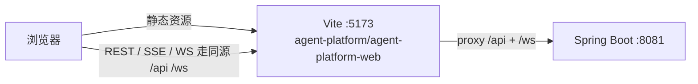
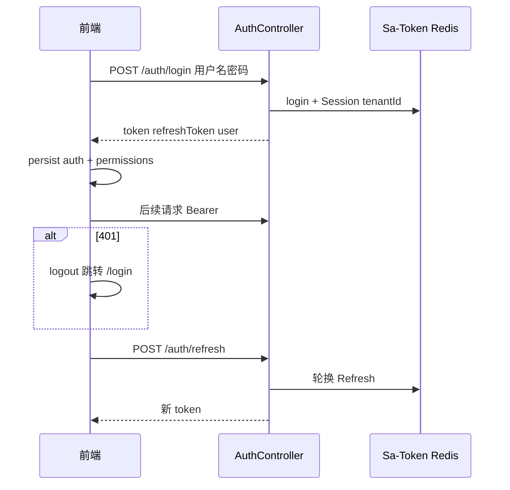
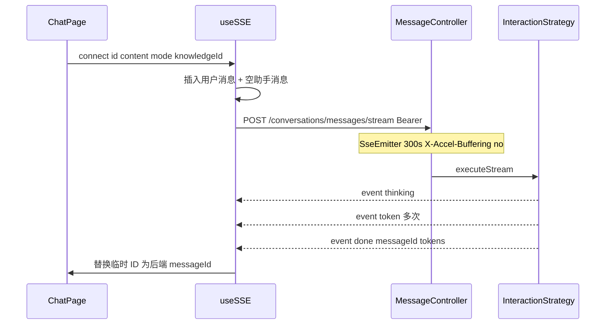
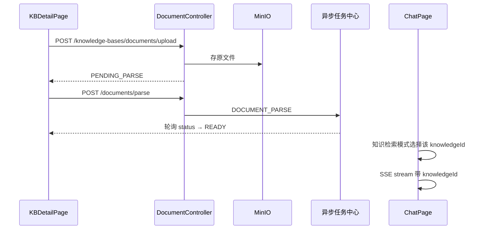
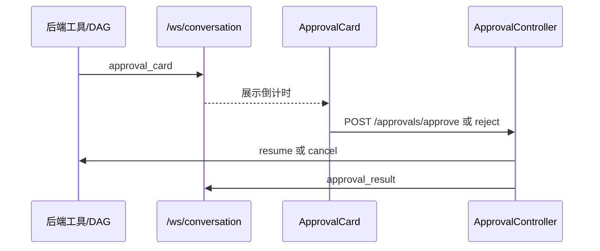

# 前后端交互设计

> 本文只写「怎么连」：通道、鉴权、权限码、时序、对照表。  
> 两端内部实现见 [01-后端架构.md](01-后端架构.md) 与 [05-前端架构.md](05-前端架构.md)。  
> 完整接口以运行中的 Knife4j 为准：`http://localhost:8081/doc.html`。

---

## 1. 部署与通道



| 通道 | 前端实现（同仓 `agent-platform-web`） | 后端实现 | 用途 |
|------|----------|----------|------|
| **REST** | `api.js` fetch，开发期经 Vite 代理到 `127.0.0.1:8081` | Controllers，前缀 `/api/v1` | CRUD、配置、同步交互 |
| **SSE** | `streamChat.js`：`fetch` + `ReadableStream`，相对路径 `/api/.../stream` | `SseEmitter`，`TEXT_EVENT_STREAM` | 流式对话 |
| **WebSocket** | 聊天页审批通道，经 `/ws` 代理到后端 | `/ws/conversation`，握手校验 Bearer | 审批卡片、进度、通知 |

开发期注意：

- 默认前端端口 **5173**（`VITE_DEV_PORT` 可改）；`/api` 与 `/ws` 由 Vite 代理到后端，避免 CORS。
- 生产若前后端不同源，SSE 也必须改成可带 Header 的绝对地址，并保证 CORS 允许该方法。
- 后端响应头 `X-Accel-Buffering: no`，反向代理不要缓冲 SSE。

风格约定：

- 几乎全部业务接口是 **POST + 动词路径**（`/list`、`/get`、`/create`），不是 REST 资源动词。
- 例外：`GET /api/v1/interactions/modes`、`GET/POST /api/v1/auth/me`、文档下载/预览部分 GET。

---

## 2. 统一响应与分页

### 2.1 信封 `Result<T>`

后端：`com.example.agent.common.result.Result`

| 字段 | 含义 |
|------|------|
| `code` | 200 成功；4xx/5xx 业务或 HTTP 语义 |
| `message` | 提示文案 |
| `data` | 载荷 |
| `timestamp` | 毫秒时间戳 |
| `await` / `executionTime` | 可选 |

前端 `src/types/api.d.ts` 额外声明了 `success: boolean`（对应 Java `isSuccess()`）。**Axios 拦截器只处理 HTTP 状态**，不根据 `code !== 200` 自动抛错。业务失败若仍返回 HTTP 200，需要 Service 或页面自己判断 `result.code`。

解包层次：

1. 拦截器：`AxiosResponse` → `Result<T>`（`response.data`）
2. Service：`result.data` → 业务 DTO

SSE **不是** `Result` 信封，而是命名事件流。

### 2.2 分页 `PageResponse<T>`

| 字段 | 约定 |
|------|------|
| `records` | 当前页列表，**不要用 items/content** |
| `total` | 总条数 |
| `page` | **0-based** |
| `size` | 页大小 |
| `totalPages` | 总页数 |

前端列表请求统一传 `{ page, size }`。

### 2.3 常用 code

| code | 场景 | 前端 |
|------|------|------|
| 200 | 成功 | 取 `data` |
| 400 | 参数错误 | 提示 `message` |
| 401 | 未登录或 Token 失效 | 清态，跳 `/login` |
| 403 | 无权限 | `message.error('权限不足')` |
| 404 | 资源不存在 | 提示 |
| 409 | 冲突 | 提示 |
| 429 | 限流 | 提示 |
| 500 | 服务器错误 | 通用「稍后重试」 |

---

## 3. 鉴权约定

Token 是 **Sa-Token random-64 会话 ID**，不是前端可解析的 JWT。前端不得 decode 权限，权限以 `/me` 或登录响应为准。

| 项 | 约定 |
|----|------|
| Header | `Authorization: Bearer <token>` |
| token-name | `Authorization` |
| Access 有效期 | dev 3600s，idle 1800s |
| Refresh | `POST /api/v1/auth/refresh`，body 带 refreshToken，服务端轮换 |
| 登出 | `POST /api/v1/auth/logout`，前端无论成功都清 localStorage |

白名单（无需登录）：

- `/api/v1/auth/login`、`/api/v1/auth/refresh`
- `/api/v1/users/register`
- Swagger / Knife4j / `/v3/api-docs/**`
- `/actuator/health|info|prometheus`
- `/ws/**`（握手阶段另校验 Bearer）
- `OPTIONS`（CORS 预检）

其余 `/api/v1/**` 需 `checkLogin`。`/api/v1/admin/**` 需角色 `ADMIN`（前端无对应管理路由）。



登录响应若无 `user`，前端再调 `POST /auth/me`；再失败则开发兜底角色 `SUPER_ADMIN`（不可进生产）。

---

## 4. 权限码对照

编码格式：`resource:action`。后端 `@SaCheckPermission` 与前端路由/菜单应对齐。

| 资源 | 后端注解（代表） | 前端路由 | 前端菜单 |
|------|------------------|----------|----------|
| 会话 | `conversation:send/read/create/...` | `/` 使用 `conversation:send` | 同左 |
| 用户 | `user:read` `user:write` | `/users` read；角色/权限页 read 或 write | 同左 |
| 租户 | `tenant:read/write`；列表页前端用 `tenant:admin` | `/tenants` → `tenant:admin` | 同左 |
| 知识库 | **`kb:read/create/update/delete/search`** | 路由 `kb:read` | 菜单 **`knowledge:read`** |
| 文档 | `doc:read/upload/update/delete` | 详情页内操作，无独立路由码 | — |
| 工具 | `tool:read/create/update` | `tool:read` | 同左 |
| 任务 | `task:read/create/execute` | `task:read` | 同左 |
| 提示词 | `prompt:read/create/update/delete/publish` | `prompt:read` | 同左 |
| 安全 | `security:read`（写操作另有 write） | `security:read` | 同左 |
| 意图 | `intent:read/create/...` | `intent:read` | 同左 |
| 评估 | `evaluation:read` | `evaluation:read` | 同左 |
| 优化 | `optimization:read` | `optimization:read` | 同左 |
| 审批 | `approval:read` | `approval:read` | 同左 |
| 交互 | `interaction:execute` `interaction:read` | `interaction:read` | 同左 |
| IM | 前端 `im:admin` | `/im/config` | 同左 |
| 可观测 | 前端 `observability:read` | traces/metrics | 同左 |

种子数据（V1.2.1）同时插入了 `kb:*` 与 `knowledge:*`。**后端接口只校验 `kb:*`。** 关闭 `DEV_BYPASS_ALL_PERMISSIONS` 后，若角色只授其中一套，会出现菜单与进页不一致。

前端常量 `PERMISSIONS` 未收录 `interaction:*`，但路由字符串已写死 `interaction:read`。

---

## 5. 核心时序

### 5.1 流式对话（双模式）



请求体：

```json
{
  "mode": "KNOWLEDGE_SEARCH",
  "conversationId": "conv_xxx",
  "content": "用户问题",
  "knowledgeId": "可选，不传则检索全部 ENABLED 库"
}
```

聊天页默认 `mode=KNOWLEDGE_SEARCH`。`useSSE.connect` 的函数默认参数是 `CONVERSATION`，以页面传入为准。

SSE 事件：

| event | data | 前端 |
|-------|------|------|
| `ping` | 心跳 | 忽略 |
| `thinking` | 纯文本 | `appendThinking` |
| `token` | 纯文本碎片 | `appendToken` |
| `tool_call` | JSON | 展示标签（后端主路径尚未推送） |
| `tool_result` | JSON | 展示结果 |
| `error` | `{ code, message }` | 标记消息错误 |
| `done` | `{ status, tokens, messageId }` | 结束流、回写真实 ID |

中止：`AbortController.abort()`。

### 5.2 知识库上传到可检索



### 5.3 消息反馈

```mermaid
sequenceDiagram
    participant Btn as FeedbackButtons
    participant Msg as MessageController
    participant Opt as BadCase 监听

    Btn->>Msg: POST /messages/feedback msgId LIKE或DISLIKE
    Note over Btn: 必须使用 done 回写的真实 messageId
    Msg->>Msg: 更新 t_message.feedback
    Msg->>Opt: MessageFeedbackEvent
    Opt-->>Opt: 点踩可开优化工单
```

### 5.4 审批卡片（设计闭环）



当前对话主路径未挂工具，该时序在联调审批页 REST 时仍可测，聊天内卡片可能无推送。

### 5.5 IM

前端 `im.ts` 调用 `/api/v1/im/channels*`。**后端无对应 Controller。** IM 页主要读 `config.json`，接口会 404。属已设计未实现（A1-04 / A7）。

---

## 6. Service ↔ Controller 对照

| 前端 service | 后端 Controller | 基路径 |
|--------------|-----------------|--------|
| `auth.ts` | `AuthController` | `/api/v1/auth` |
| `users.ts` | `UserController` | `/api/v1/users` |
| `roles.ts` | `RoleController` | `/api/v1/roles` |
| `permissions.ts` | `PermissionController` | `/api/v1/permissions` |
| `tenants.ts` | `TenantController` | `/api/v1/tenants` |
| `conversation.ts` | `ConversationController` | `/api/v1/conversations` |
| `message.ts` + `useSSE` | `MessageController` | `/api/v1/conversations/messages` |
| `feedback.ts` | Message + Optimization | feedback + `/optimization-tickets/feedback/stats` |
| `interaction.ts` | `InteractionController` | `/api/v1/interactions` |
| `knowledge.ts` | `KnowledgeBaseController` | `/api/v1/knowledge-bases` |
| `document.ts` | `DocumentController` + `FileManagementController` | `/api/v1/documents`、`/knowledge-bases/files/*`、upload |
| `search.ts` | `KnowledgeSearchController` | `/api/v1/knowledge` |
| `tools.ts` | `ToolController` | `/api/v1/tools` |
| `tasks.ts` | `TaskController` | `/api/v1/tasks` |
| `prompts.ts` | `PromptController` | `/api/v1/prompts` |
| `security.ts` | `SecurityFenceController` | `/api/v1/security` |
| `intents.ts` | `IntentController` | `/api/v1/intents` |
| `evaluation.ts` | Dataset + Run Controllers | `/api/v1/evaluation` |
| `optimization.ts` | `OptimizationTicketController` | `/api/v1/optimization-tickets` |
| `approvals.ts` | `ApprovalController` | `/api/v1/approvals` |
| `im.ts` | **无** | `/api/v1/im/**` 会失败 |

另有后端 `PrecisionController`：`/api/v1/knowledge-bases/precision/evaluate|optimize`，前端知识详情若未接则仅能走 set-precision-config。

文件下载/预览存在 POST 与 GET 两套（`DocumentController`），前端 `document.ts` 以 POST download 为主；浏览器直链预览用 GET。

---

## 7. WebSocket 消息类型

前端 `useWebSocket` 约定：

| 方向 | type | 用途 |
|------|------|------|
| 下行 | `approval_card` | 聊天内卡片 |
| 下行 | `approval_result` | 审批结果 |
| 下行 | `task_progress` | 任务进度 |
| 下行 | `system_notification` | 系统通知 |
| 下行 | `permission_changed` | 权限变更（前端可提示重新登录） |
| 下行 | `pong` | 心跳响应 |
| 上行 | `ping` | 心跳 |
| 上行 | `approval_response` | 卡片内提交（若走 WS 而非 REST） |
| 上行 | `chat_message` | 预留 |

心跳：30s ping，60s 无 pong 视为断线；重连延迟 `[1000,2000,4000,8000,16000]`，最多 5 次。

---

## 8. 联调检查清单

1. 后端 `:8081` 已启动，库 `agent_platform_dev` 已执行 V1.0.0–V1.7.0。
2. 前端同仓工程 `agent-platform/agent-platform-web`，开发端口 `:5173`；`VITE_BACKEND_URL` 指向 8081（默认 `http://127.0.0.1:8081`）。
3. 用种子管理员登录；管理菜单按权限码显示（如 `kb:*`、`intent:*`、`user:*`）。
4. 浏览器 Network：REST/SSE/WS 均经 5173 同源代理，确认 `/api` 为 200 且流式为 `text/event-stream`。
5. SSE 若长时间无 token：查反向代理缓冲、Emitter 超时、模型 Key。
6. WS 连不上：握手是否带 Token；白名单 `/ws/**` 只放行升级，业务仍要合法 Bearer。
7. 401 循环跳登录：Token 未写入或 Header 不是 `Bearer ` 前缀。
8. 若绕过代理直连 8081，Origin 为 `http://localhost:5173`，需后端 CORS 放行（域名可从 Nacos `SecurityConfig` 读）。
9. 上传 50MB：前后端 multipart 上限一致（后端 50/100MB）。
10. 不要对 SSE 使用 Axios（无法正确消费流）。

---

## 9. 交互层已知缺口

| 缺口 | 影响 |
|------|------|
| IM API 前端有、后端无 | IM 配置页接口失败 |
| SSE 相对 URL vs REST 绝对 URL | 本地能通，部署拓扑一变容易漏改 |
| 权限码 `kb` vs `knowledge` | 关闭开发旁路后菜单/路由分裂 |
| 拦截器不校验业务 `code` | HTTP 200 + code=500 可能被当成成功 |
| 工具/审批未进 stream | 前端已处理 `tool_*` 与卡片，联调无事件 |
| 前端 refresh 流程 | `auth.ts` 有 refresh 方法，需确认是否在 401 前自动调用（当前拦截器 401 直接登出） |

自动 Refresh 未接入拦截器时，AccessToken 过期即跳登录，即使用户仍持有有效 RefreshToken。
