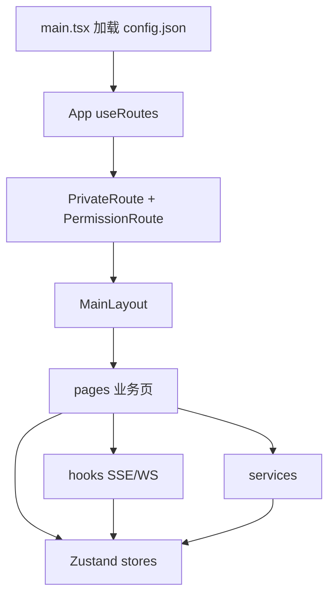
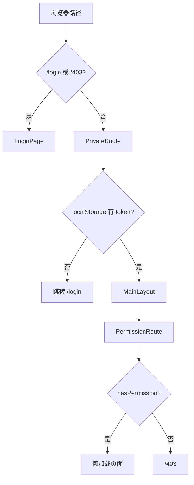

# 前端整体设计与架构

> 工程路径：`agent-platform/agent-platform-web`（与后端同仓；根目录独立前端仓已移除）  
> 版本：随同仓前端  
> 定位：Agent Platform **P5 交互端** — 流式对话 + 管理后台一期  
> 配套：[06-前端功能.md](06-前端功能.md) · [04-前后端交互.md](04-前后端交互.md)  
> 说明：下文部分目录/技术细节仍反映早期全量管理台设计；落地以同仓 `agent-platform-web` 为准（默认开发端口 **5173**）。

---

## 1. 系统定位

前端是纯静态 SPA：浏览器加载资源后，所有业务数据来自后端 `agent-platform`。不承担鉴权真相、不直接连 MySQL/Milvus。

设计目标：

| 目标 | 落地 |
|------|------|
| 前后端分离 | Vite 构建静态资源；运行时 `public/config.json` 配 API 地址 |
| 配置化驱动 | 超时、功能开关、IM、上传限制均可不改代码调整 |
| 模块化 | `pages` 按业务域拆分，路由 `React.lazy` 按需加载 |
| 类型安全 | TypeScript；API 类型手写在 `src/types`（无 OpenAPI 代码生成） |
| 实时通道 | SSE 流式对话 + WebSocket 审批/通知 |
| 桌面优先 | Ant Design 中后台布局，侧栏 + Header + Outlet |

无独立「Agent 配置」页面。创建会话时 `agentId` 写死为 `'default'`，与后端默认 Agent 常量对齐。

---

## 2. 目录与分层

路径别名 `@` → `src/`（`vite.config.ts` + `tsconfig.json`）。**没有 `src/api`**，HTTP 层在 `src/services/`。

```
agent-platform/agent-platform-web/
├── index.html
├── package.json
├── vite.config.js                  # 默认端口 5173，代理 /api 与 /ws
├── .env.development / .env.example
└── src/
    ├── main.tsx                    # loadAppConfig → 挂载根组件
    ├── App.tsx                     # ErrorBoundary + useRoutes
    ├── config/                     # 路由表、常量、运行时配置
    ├── router/                     # PrivateRoute / PermissionRoute
    ├── layouts/MainLayout.tsx      # 侧栏 + Header + Outlet
    ├── pages/                      # 按业务域的页面
    ├── components/                 # 通用：Chat / Authorized / ApprovalCard
    ├── services/                   # Axios 封装 + 按域 API
    ├── stores/                     # Zustand
    ├── hooks/                      # useSSE / useWebSocket / usePermission
    ├── types/                      # TS 类型
    ├── utils/format.ts
    ├── assets/styles/              # Less
    └── styles/chat.css
```



启动顺序：`loadAppConfig()` 必须在首次 API 调用之前完成，因为 `apiClient` 惰性读取 `baseURL`。

---

## 3. 技术选型与原因

### 3.1 核心栈

| 类别 | 技术 | 版本 | 为什么选 | 不选 |
|------|------|------|----------|------|
| 框架 | React | 18.3 | 生态与中后台组件成熟 | Vue（团队与 Ant Design 5 更贴 React） |
| 语言 | TypeScript | ~5.6 | 接口字段与权限码需要编译期约束 | 纯 JS |
| 构建 | Vite | 5.4 | 开发启动快、原生 ESM | Webpack CRA |
| UI | Ant Design 5 | ^5.22 | 企业表格/表单/布局成本最低 | 自研组件库 |
| 路由 | React Router 6 | ^6.28 | 嵌套布局 + 懒加载官方模式 | Next.js（不需要 SSR） |
| 状态 | Zustand 4 | ^4.5 | API 短、天然 TS、体积小 | Redux（样板多）、MobX |
| HTTP | Axios 1.7 | ^1.7 | 拦截器适合统一 Bearer 与错误码 | fetch 裸用（REST 场景） |
| 流式 | **fetch + ReadableStream** | 浏览器原生 | SSE 必须 **POST + Authorization** | EventSource（只支持 GET，不能自定义 Header） |
| 实时 | 原生 WebSocket | — | 协议简单；心跳/重连自管即可 | Socket.IO（后端不是该协议） |
| Markdown | react-markdown + Prism | 9 / 15 | AI 回复含代码块 | 自己解析 |
| 长列表 | react-window | 1.8 | 历史消息可变高度虚拟滚动 | 全量 DOM |
| 日期 | dayjs | 1.11 | Ant Design 5 默认 | moment |
| 样式 | Less | 4.2 | 与 antd 主题变量共存 | CSS-in-JS 全家桶 |

### 3.2 已安装但未真正使用

早期方案文档写了「已用」，源码现状如下：

| 依赖 | 现状 |
|------|------|
| `@tanstack/react-query` | `main.tsx` 已挂 `QueryClientProvider`，**页面未使用 `useQuery`/`useMutation`** |
| `react-hook-form` | **未 import**；表单用 antd `Form` |
| `@ant-design/charts` | **未 import**；指标页为占位 |
| `@xyflow/react` | **未 import**；任务页用 Table 展示步骤，无 DAG 图 |

保留依赖是为后续仪表盘与任务可视化预留，当前实现不要按「已经接上」来写方案。

### 3.3 为什么 Zustand 而不是 Redux

- 认证、权限、当前会话、流式消息属于少量全局状态，不需要中间件生态。
- persist 中间件直接落 localStorage，刷新保登录。
- `apiClient` 通过 `setAuthHandlers` 回调取 token，避免 `services ↔ stores` 循环依赖。

列表页普遍是 `useState` + `useEffect` 调 service，服务端缓存层（React Query）尚未铺开。

---

## 4. 路由与权限架构

### 4.1 守卫顺序



工厂 `wrapRoute`：内层权限、外层登录，再包 `Suspense`。所有业务子路由挂在 `MainLayout` 的 `Outlet`。

### 4.2 三层权限

| 层 | 位置 | 行为 |
|----|------|------|
| 路由 | `PermissionRoute` | 无权限跳 `/403` |
| 菜单 | `MainLayout` 过滤 `MENU_GROUPS` | 看不见入口 |
| 组件 | `Authorized` / `AuthorizedButton` | 隐藏按钮 |

匹配规则（`usePermissionStore`）：

- 角色 `SUPER_ADMIN` 全通
- 权限 `*` 全局通配
- `resource:*` 资源通配
- 否则精确匹配 `resource:action`

**开发旁路：`DEV_BYPASS_ALL_PERMISSIONS = true`。** 为 true 时 `hasPermission` / `hasRole` 恒为 true，菜单与路由全部放开。上线前必须改为 `false`。

### 4.3 已知权限码不一致

| 位置 | 使用的码 |
|------|----------|
| 路由 `/knowledge` | `kb:read` |
| 侧栏「知识库列表」 | `knowledge:read` |
| 后端注解 | `kb:*` |

开发旁路打开时不会暴露该问题；关闭后可能出现「菜单可见但进页 403」或相反。后端种子同时插入了两套码，角色是否都授予取决于种子是否完整赋权。

前端 `PERMISSIONS` 常量（`src/types/permission.ts`）目前**未包含** `interaction:read` / `interaction:execute`，但路由已使用 `interaction:read`。

---

## 5. 状态分层

| Store | 持久化 Key | 职责 |
|-------|------------|------|
| `useAuthStore` | `agent-platform-auth` | token / refreshToken / userId / username / tenantId |
| `usePermissionStore` | `agent-platform-permission` | permissions、roles、校验方法 |
| `useTenantStore` | `agent-platform-tenant` | 当前租户 ID |
| `useChatStore` | 否 | 消息列表、流式 token/thinking/tool、审批标记 |
| `useConversationStore` | 否 | 会话列表、activeId |
| `useUserStore` | 否 | 用户页 Modal 开关 |

原则：

- **登录态必须 persist**，否则刷新即掉。
- **聊天消息不 persist**，避免 localStorage 膨胀；切会话时重新拉历史。
- 列表筛选、分页留在页面本地 state。

---

## 6. API 层设计

`src/services/apiClient.ts`：

1. 惰性创建 Axios，读取 `config.json` 的 `api.baseURL` 与 `timeout`
2. 请求拦截：`Authorization: Bearer ${token}`
3. 响应拦截：成功返回 `response.data`（解开 Axios 层，**不解开** 后端 `Result.data`）；401 调用 logout 并跳 `/login`；403/5xx 用 antd `message`
4. Service 再取 `result.data`

约定：

- `API_PREFIX = '/api/v1'`
- Service 基本全是 **POST**（与后端动词路径一致）
- 分页：`page` 从 0 开始，列表在 `records`

SSE 不走 Axios：`useSSE` 使用 `fetch`，以便 `ReadableStream` 逐块解析 `event:` / `data:`。

WebSocket：`useWebSocket` 连 `config.websocket.url`，心跳 30s，超时 60s，指数退避重连。

---

## 7. 构建与联调

| 项 | 值 |
|----|----|
| 开发端口 | Vite **3000** |
| 代理 | `/api` → `http://localhost:8081`（含 `ws: true`） |
| 运行时 baseURL | `public/config.json` 为 `http://127.0.0.1:8081` |
| 后端 | Spring Boot **8081** |

注意：开发时若 `baseURL` 指向 8081 绝对地址，请求**不走 Vite 代理**，依赖后端 CORS。若改为相对路径 `/api`，则走代理。当前 `config.json` 是直连 8081。

功能开关（`config.features`）：知识库、任务规划、优化、可观测性等；页面是否真正隐藏还取决于菜单实现（部分开关尚未驱动菜单过滤）。

---

## 8. 页面地图

| 路径 | 页面 | 路由权限 |
|------|------|----------|
| `/login` | 登录 | 公开 |
| `/403` | 权限不足 | 公开 |
| `/` | 智能对话 | `conversation:send` |
| `/home` | 仪表盘占位 | 仅登录 |
| `/interactions` | 交互测试 | `interaction:read` |
| `/users` `/roles` `/permissions` | 用户体系 | `user:read` / `user:write` |
| `/tenants` | 租户 | `tenant:admin` |
| `/approvals` | 审批中心 | `approval:read` |
| `/knowledge` `/:id` | 知识库 | `kb:read` |
| `/tools` `/:id` | 工具 | `tool:read` |
| `/tasks` | 任务规划 | `task:read` |
| `/prompts` `/:id` | 提示词 | `prompt:read` |
| `/security/words` `/events` | 围栏 | `security:read` |
| `/intents` | 意图 | `intent:read` |
| `/evaluation/datasets` `/runs` | 评测 | `evaluation:read` |
| `/optimization` `/:id` | 工单 | `optimization:read` |
| `/observability/traces` `/metrics` | 占位 | `observability:read` |
| `/im/config` | IM 配置 | `im:admin` |

功能级设计见 [06-前端功能.md](06-前端功能.md)。
