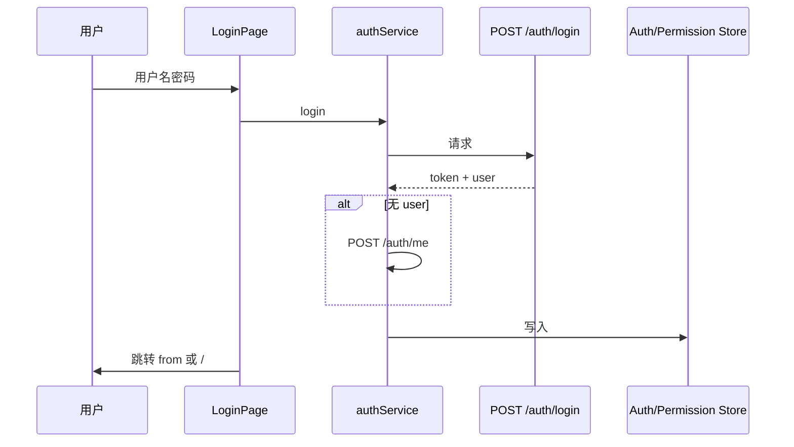
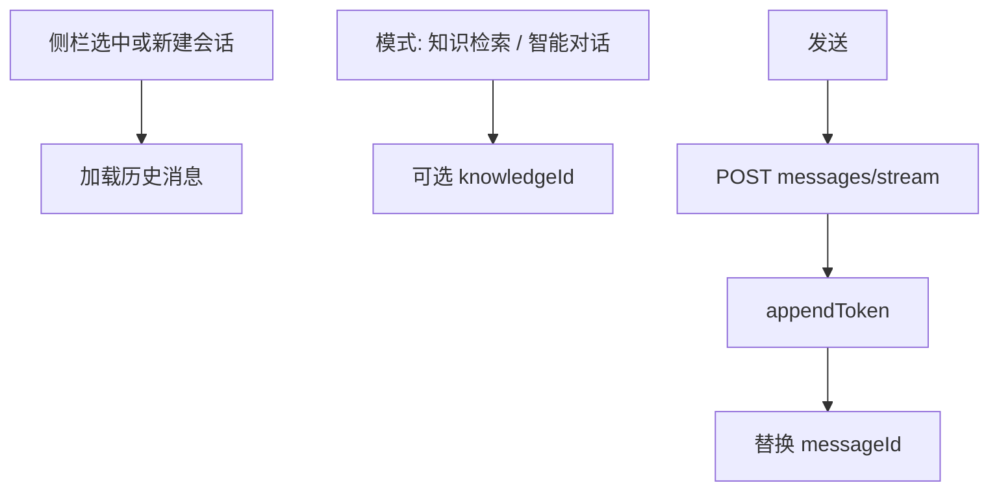
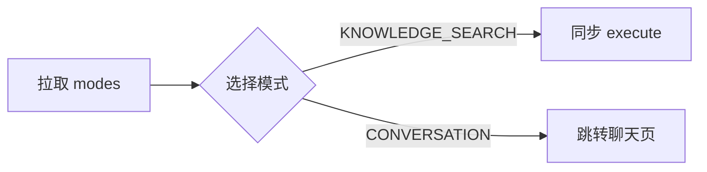
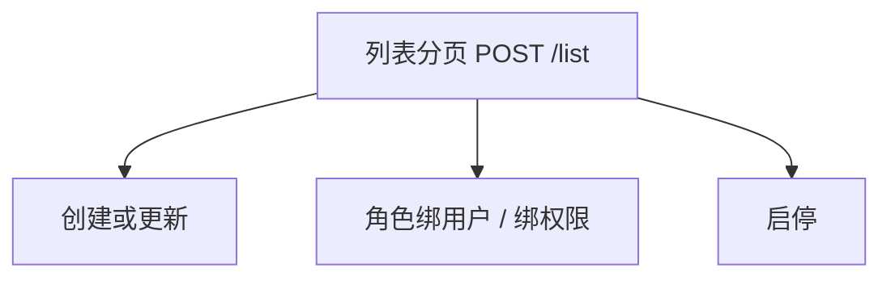
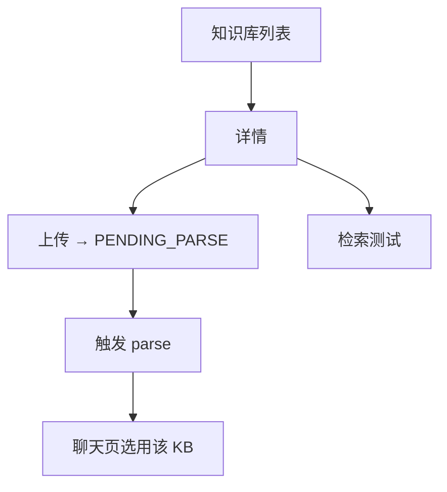
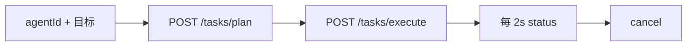
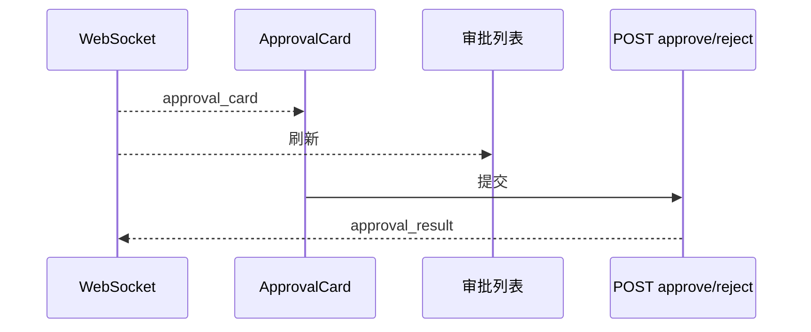

# 前端功能设计

> 本文是前端「分」文档：按页面模块展开。  
> 每章统一四段：**设计思路 → 技术选型原因 → 实现思路 → 流程图**。  
> 配套：[05-前端架构.md](05-前端架构.md) · [04-前后端交互.md](04-前后端交互.md)

---

## 1. 登录与会话保持

### 设计思路

管理台必须先认证再进业务。登录页只收集用户名密码；成功后同时写入 Token 与权限，后续请求由 Axios 拦截器自动带 Bearer。刷新页面不能掉登录，因此 Token 进 localStorage。无验证码、无 SSO、租户字段预留未展示。

### 技术选型原因

| 选择 | 原因 |
|------|------|
| antd Form | 与全站表单一致，校验成本低 |
| Zustand persist | 刷新保登录，不必上 Cookie 方案（后端是 Header Token） |
| `/me` 兜底 | 登录响应若未带 user，再拉一次权限 |
| 失败时开发兜底 `SUPER_ADMIN` | 联调不被权限挡住；生产必须删除 |

### 实现思路

- 页面：`pages/Login/LoginPage.tsx`
- `authService.login` → 写 `useAuthStore` + `usePermissionStore`
- 回跳 `location.state.from` 或 `/`
- 登出：Header 调 `logout` + `POST /auth/logout`，清本地态
- 401：拦截器清态并跳 `/login`

### 流程图

---

## 2. 智能对话

### 设计思路

默认首页就是对话：左侧会话列表，右侧消息流。产品上知识检索是主场景，因此默认模式 `KNOWLEDGE_SEARCH`，可切 `CONVERSATION`。流式输出要像 ChatGPT：边到边渲染 Markdown，可中止生成。助手气泡承载思考过程、工具标签、点赞点踩、审批卡片。

无独立 Agent 选择器：侧栏新建会话 `agentId: 'default'`。

### 技术选型原因

| 选择 | 原因 |
|------|------|
| fetch SSE 而非 EventSource | 必须 POST，且带 Bearer |
| Zustand `useChatStore` | token 高频 append，避免整页重绘上下文层层传 |
| react-markdown + Prism | 模型输出代码块高频 |
| react-window 可变高度 | 长会话 DOM 爆炸 |
| AbortController | 用户点停止立即断开 |

### 实现思路

- `ChatPage` + `ConversationSidebar`
- 新建：`conversationService.create({ agentId: 'default' })`
- 选中会话：`messageService` 拉历史，映射为前端 `Message`
- 发送：插入用户消息 + 空助手消息 → `useSSE.connect(conversationId, content, mode, knowledgeId)`
- SSE 事件：`token` 追加；`thinking` 折叠区；`tool_call`/`tool_result` 标签；`done` 用后端 `messageId` 替换临时 ID（反馈需要真实 ID）；`error` 提示；`ping` 忽略
- 知识检索模式：加载 KB 列表，可选 `knowledgeId`（不选则后端搜全部 ENABLED 库）
- 组件：`MessageList`、`MessageBubble`、`InputArea`、`TypingIndicator`、`FeedbackButtons`、`ApprovalCard`

### 流程图

---

## 3. 交互测试页

### 设计思路

给开发/运营一个同步入口：列出后端已注册模式，对知识检索跑一次非流式 execute，避免必须开聊天框才能试检索。对话模式则跳转聊天页走 SSE。

### 技术选型原因

同步 JSON 比 SSE 更易断言；复用 `interactionService`，不另做 Mock。

### 实现思路

- 路由 `/interactions`，权限 `interaction:read`
- `GET /interactions/modes` 展示模式
- 知识检索：`POST /interactions/execute`
- 对话模式：`navigate('/')`

### 流程图

---

## 4. 用户、角色、权限、租户

### 设计思路

中后台标准 CRUD：用户启停改密、角色绑用户绑权限、权限列表与 JSON 批量导入、租户启停删除。权限模型与后端 RBAC 一一对应，前端不做第二套码表（常量文件仅作 TS 提示）。

### 技术选型原因

antd Table + Modal + Form 覆盖列表与编辑；批量导入用 JSON 文本域，避免做 Excel 解析。

### 实现思路

- `/users`：`UserListPage`，`userService`
- `/roles`：`RoleManagement`，`roles` + `permissions` 服务
- `/permissions`：`PermissionConfig`，支持 import
- `/tenants`：`TenantListPage`，权限 `tenant:admin`
- `useUserStore` 只存 Modal 开关

角色页路由权限是 `user:read` **或** `user:write`（`requiredPermissions` 默认任一即可）。

### 流程图

---

## 5. 知识库

### 设计思路

两级页面：列表管知识库生命周期；详情管精度/切片、文档上传解析、检索试探。聊天页只消费「已启用的库」，配置工作集中在详情页。上传与解析分离，与后端手动 parse 一致。

### 技术选型原因

| 选择 | 原因 |
|------|------|
| 列表/详情拆路由 | 详情状态多，避免一个巨型页 |
| antd Upload | 50MB 与 pdf/docx/txt/md 限制与 `UPLOAD_CONFIG` 对齐 |
| 检索测试调 search + interaction | 运营可在入库后立刻验证召回 |

### 实现思路

- `/knowledge`：`KBListPage` CRUD、启停
- `/knowledge/:knowledgeId`：`KBDetailPage`
  - 切片/精度配置
  - 文档上传、parse / batch-parse、切片查看、下载预览、废弃删除
  - 检索测试
- 服务：`knowledge.ts`、`document.ts`、`search.ts`

菜单权限写 `knowledge:read`，路由写 `kb:read`，见架构文档不一致说明。

### 流程图

---

## 6. 工具平台

### 设计思路

工具是可运营对象：注册类型、在线测试、看调用日志、版本列表与回滚。详情页承担版本与日志，列表页承担检索与启停。

### 技术选型原因

JSON Schema 用文本/JSON 编辑而非可视化表单，先保证与后端 `schema_json` 对齐。xyflow 未用于工具拓扑（工具是注册表，不是图）。

### 实现思路

- `/tools`、`/tools/:toolId`
- `toolsService`：create/list/get/update/toggle/test/invocations/versions/rollback
- 类型展示：HTTP / gRPC / FUNCTION / MCP（以后端实际枚举为准）

对话内自动调工具 **后端未接线**，本页「测试」是管理态调用。

---

## 7. 任务规划

### 设计思路

运营输入 `agentId` + 目标，先 `plan` 再 `execute`，轮询 `status`，可 `cancel`。当前用表格展示步骤，不画 DAG。

### 技术选型原因

2s 轮询比 WebSocket 任务进度更简单；`@xyflow/react` 已依赖未接，避免半成品图误导。

### 实现思路

- `/tasks`：`TaskPlanPage`
- `tasksService.plan` → 展示 plan → `execute` → `setInterval` 拉 status
- 无独立异步任务（文档解析）管理页

### 流程图

---

## 8. 提示词编辑器

### 设计思路

列表管模板生命周期；编辑器管正文、变量、预览渲染、版本 diff、发布/回滚/归档。与代码托管类似的「草稿 vs 已发布」。

### 技术选型原因

diff 用后端 `/diff` 结果展示，不在浏览器做文本算法。预览走 `/preview` 或 `/render`，保证与线上 Resolver 链一致。

### 实现思路

- `/prompts`：`PromptListPage`
- `/prompts/:id`：`PromptEditor`
- `promptsService` 覆盖 create/update/publish/rollback/archive/versions/diff/render

主聊天 **不会自动用** 这里发布的模板（后端未注入）。

---

## 9. 安全围栏与意图

### 设计思路

敏感词与安全事件是运营配置/审计页；意图是规则与示例的配置 + 单条/批量测试。前端不实现匹配算法。

### 实现思路

- `/security/words`：精确/正则/模糊、严重级别、启停
- `/security/events`：按时间/会话筛选
- `/intents`：CRUD、启停、`test` / `batch-test`
- 权限：`security:read`、`intent:read`（写操作另需后端 `write` 类权限）

围栏规则配好后，**当前不会自动作用到聊天 stream**。

---

## 10. 效果评估与优化工单

### 设计思路

评估：数据集 → 条目 → 跑批 → 看历史运行。优化：工单列表/详情，指派、改状态、填写解决说明；反馈统计入口在工单模块。

### 实现思路

- `/evaluation/datasets`、`/evaluation/runs`
- `/optimization`、`/optimization/:ticketId`
- `evaluationService`、`optimizationService`
- 聊天点踩可间接触发后端开单（事件驱动），本页做人工闭环

---

## 11. 审批中心

### 设计思路

双入口：聊天里的 `ApprovalCard`（倒计时、风险等级、同意/拒绝）+ `/approvals` 列表（待办/已办/我发起）。列表依赖 WebSocket 刷新，避免人工狂点查询。

### 技术选型原因

卡片组件与列表页共享 `approvalsService`；实时用 WS 消息类型 `approval_card` / `approval_result`。

### 实现思路

- `ApprovalListPage` Tab + 同意/拒绝
- `useWebSocket` 收到卡片则刷新或写入 `useChatStore.setApprovalRequired`
- 后端主路径未挂工具时，卡片可能长期无数据，页面仍可用手工测 REST

### 流程图

---

## 12. 可观测性、IM、仪表盘（占位）

### 设计思路

信息架构先把入口放进菜单，避免后端 Grafana/IM 就绪后再改路由。页面明确告诉用户数据在 Actuator/Prometheus，而不是假图表。

### 实现思路

| 页面 | 现状 |
|------|------|
| `/home` | 欢迎文案，非仪表盘 |
| `/observability/traces` | Empty 占位 |
| `/observability/metrics` | 指向 `/actuator/*`，待 Grafana 或 charts |
| `/im/config` | 读 `config.json` 的 wecom/dingtalk 开关与二维码，无后端 IM 适配 |

`config.features.enableObservability` 默认 false，与菜单是否隐藏需对照 `MainLayout`（当前菜单仍可能展示，开发旁路下均可进入）。

---

## 13. 通用组件

| 组件 | 作用 |
|------|------|
| `Authorized` / `AuthorizedButton` | 按钮级权限 |
| `ErrorBoundary` | 路由级错误隔离 |
| `MessageBubble` | Markdown、思考、工具、反馈、审批 |
| `ChannelStatusBadge` | IM 渠道状态 |

---

## 14. 前端缺口汇总

| 项 | 说明 |
|----|------|
| Agent 配置页 | 无；`agentId` 写死 default |
| 权限旁路 | `DEV_BYPASS_ALL_PERMISSIONS = true` |
| 菜单 vs 路由 KB 权限码 | `knowledge:read` vs `kb:read` |
| React Query / charts / xyflow / RHF | 已装未用 |
| 可观测性 / 仪表盘 / IM 后端 | 占位 |
| `/me` 失败兜底 SUPER_ADMIN | 仅适合开发 |
| 登录无租户/SSO/验证码 | 与后端 LDAP/SSO 未产品化一致 |

下一篇：[04-前后端交互.md](04-前后端交互.md)
