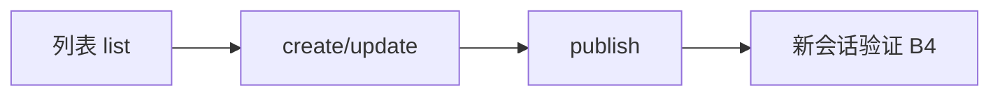

# A1-05 提示词模板列表与发布（前端）

> **类别**: A | **优先级**: P1 | **状态**: ✅ 已完成（2026-11-24）  
> **来源已办**: B4 / B12（运行时已消费 PUBLISHED 模板，管理面无 UI）  
> **关联**: `PromptController` `/api/v1/prompts`；`docs/00-总体设计/06-前端功能.md` §8  
> **依赖**: 管理后台一期壳（`/admin`）

## 1. 现状与缺口

后端可 create/list/update/delete/publish/archive；前端无 `/admin/prompts`，运营无法发布模板供对话使用。

## 2. 解决什么场景

管理员维护租户下模板清单，将草稿发布为线上人设/RAG 系统提示，无需改代码。

## 3. 为什么这样设计

- 本项只闭环 **列表生命周期**：创建、编辑元数据、发布、归档、删除。  
- 正文大编辑器、版本 diff、回滚见 **A1-06**，避免单页过大。  
- 发布后可用聊天验证 B4（改 `chat.system` / `rag.system` 后新会话生效）。

## 4. 技术栈

同现有 admin：React + Ant Design Table/Modal/Form；`api.js` 增 `prompts` 方法；菜单权限 `prompt:read` / `prompt:write`。

## 5. 实现方案

1. 路由 `/admin/prompts`，菜单「提示词」。  
2. 列表：名称、状态（DRAFT/PUBLISHED/ARCHIVED）、更新时间、操作。  
3. 新建/编辑弹窗：name、description、content（可用 TextArea；精编进 A1-06）。  
4. 操作：发布、归档、删除；无权限隐藏按钮。  
5. 空态与错误 toast 对齐一期知识库页。

## 6. 流程图

## 7. 验收标准

- 有 `prompt:read` 可见菜单；无写权限不能发布。  
- 发布成功后状态变为 PUBLISHED；归档后对话不再选用（与后端约定一致）。  
- 本页不依赖 A1-06 即可独立验收。

## 8. 风险

模板 name 与 B4 约定（`chat.system` / `rag.system`）不一致时「发布了也不生效」——列表页对约定名给 Tooltip 提示。
