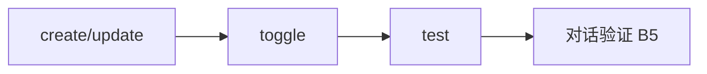

# A1-07 工具注册与在线测试（前端）

> **类别**: A | **优先级**: P1 | **状态**: ✅ 已完成（2026-11-24 16:41）  
> **来源已办**: B5（对话可 function call；管理页仍无）  
> **关联**: `ToolController` `/api/v1/tools`；`06-前端功能.md` §6  
> **依赖**: `/admin` 壳

## 1. 现状与缺口

工具只能靠 API/Swagger 注册；聊天侧已能展示 `tool_call`/`tool_result`，运营无法在 UI 启停与试调。

## 2. 解决什么场景

注册 HTTP/MCP 工具、填写 schema、一键 test，确认后再放到对话白名单。

## 3. 为什么这样设计

- 本项闭环 **注册 → 启停 → 在线测试**。  
- 调用日志与版本回滚见 **A1-08**。  
- 对话内自动调用不在本项范围（B5 已办）。

## 4. 技术栈

React + antd；`schema_json` / 配置用 JSON TextArea；权限对齐后端 `tool:read` / `tool:create` / `tool:update`（文档中的 `tool:write` 为统称）。

## 5. 实现方案

1. 路由 `/admin/tools`：表格（名称、类型、状态、更新时间）。  
2. 新建/编辑：type、endpoint/MCP 元数据、schema_json、`requireApproval`。  
3. 启停 `toggle-status`。  
4. 「测试」弹窗填 params → `POST /tools/test`，展示结果与耗时。  
5. 密钥字段掩码，不回显完整 secret。

## 6. 流程图

## 7. 验收标准

- 注册 HTTP echo 工具后，本页 test 成功。  
- 禁用后对话侧不可再调（与后端 ACTIVE 过滤一致）。  
- 无写权限（`tool:create`/`tool:update`）不能创建/编辑/启停；测试需 `tool:read`（与后端一致）。

## 8. 风险

MCP 配置字段因类型而异：表单按 type 切换必填项，避免一个大 JSON 难用。

## 9. 完成说明

- 前端：`ToolList.jsx`、`/admin/tools` 菜单与路由；`api.js` 对接 list/get/create/update/toggle-status/test。  
- 后端：`ToolResponse` 对 apiKey/token/password 掩码回显；更新时忽略掩码/空串，避免覆盖真实密钥。  
- 日志与版本回滚仍属 A1-08，本页未做详情页。

## 10. 追加：描述 AI 润色（2026-11-24 16:53）

- `POST /api/v1/tools/generate-description`：草稿 → 润色描述预览，不落库；权限 `tool:create` 或 `tool:update`。  
- 弹窗「描述」旁「AI 生成」→ 只读预览 →「填充到描述」→ 可再手改后保存。
