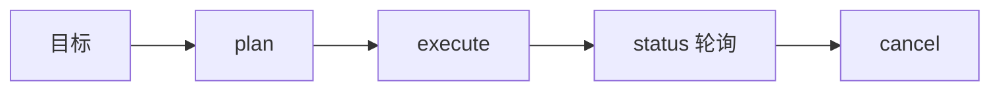

# A1-09 任务中心规划执行（前端）

> **类别**: A | **优先级**: P1 | **状态**: ✅ 已完成（2026-11-24 17:12）  
> **来源已办**: A2-01（`TASK_EXECUTION` 策略已进对话；独立 Task REST 无页）  
> **关联**: `TaskController` `/api/v1/tasks`；`06-前端功能.md` §7  
> **依赖**: `/admin` 壳；可选对照聊天模式联调

## 1. 现状与缺口

聊天可选「任务执行」并有 `task_plan`/`task_step` 块；运营/开发无独立页做 plan → execute → 轮询 status → cancel。

## 2. 解决什么场景

不依赖自然语言，直接对 agent 目标做规划与执行排障；查看 Handler 列表。

## 3. 为什么这样设计

- 一期用 **表格展示步骤**，不上 xyflow（依赖已装未用，避免半成品图）。  
- 2s 轮询 status，与文档一致；本项不接 WS。  
- 与聊天模式并行存在：本页偏运维，聊天偏用户。

## 4. 技术栈

React + antd Form/Table；权限以后端注解为准：`task:read` / `task:create` / `task:execute`（无 `task:write`）。

## 5. 实现方案

1. 路由 `/admin/tasks`。  
2. 表单：agentId（默认 default）、目标描述 → `plan` → 展示节点表。  
3. `execute` → 保存 executionId → `setInterval` 调 `status`。  
4. `cancel`；`handlers` 只读展示可用 Handler。  
5. 失败态展示错误信息，停止轮询。

## 6. 流程图

## 7. 验收标准

- 对示例 Handler 能 plan 出步骤并 execute 到终态（SUCCESS/FAILED）。  
- 执行中 cancel 后 status 为取消类终态。  
- 离开页清除 interval，无内存泄漏。

## 8. 风险

C6 未完成时仅三示例 Handler 可跑——页内注明，避免当成产品故障。

## 9. 完成说明

- 前端：`TaskPlanPage.jsx`，路由 `/admin/tasks`；菜单与 `canAccessAdmin` 纳入 `task:read` / `task:create` / `task:execute`。`api.js` 对接 plan、plan/get、execute、status、cancel、handlers。规划后表格展示节点；执行后每 2 秒轮询 status，终态（COMPLETED / FAILED / CANCELLED）、等待审批或请求失败时停止；离开页面清除 interval。
- 后端：沿用已有 `TaskController`，本项未新增接口。
- 未做：xyflow DAG 图、WebSocket 进度、生产级 ActionHandler（C6）。高风险步骤停在 `WAITING_APPROVAL` 时本页只展示，不提供恢复。
