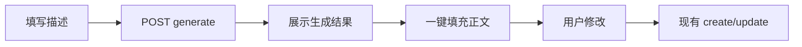

# A1-20 提示词描述生成模板

> **类别**: A | **优先级**: P2 | **状态**: ✅ 已完成（2026-11-24 16:16）  
> **关联**: `PromptController` `/api/v1/prompts`；已办 A1-05 列表弹窗  
> **依赖**: A1-05（`/admin/prompts` 新建/编辑弹窗已有「描述」与「正文」）

## 1. 现状与缺口

新建/编辑弹窗要手写 `templateText`。描述只作元数据保存，不能据此生成正文。仓库没有 `/prompts/generate`。同步补全已有 `DeepSeekUtilityClient.completeText`（关闭 thinking），主对话仍走 ChatClient 流式，本项不走 SSE。

## 2. 解决什么场景

管理员先写清模板用途（描述），点一次生成，看到模型给出的系统提示词，确认后填入下方正文，再自行修改并保存。生成结果不单独落库。

## 3. 为什么这样设计

- 生成与保存分开：预览后再填充，避免模型输出直接覆盖用户已写正文。  
- 走同步工具客户端，而不是对话流：一次返回整段正文，不占用会话、不推 SSE。  
- 不新增权限码：能新建或能编辑草稿的人即可生成。  
- 版本 diff / 回滚仍属 A1-06，本项只加在现有弹窗上。

## 4. 技术栈

后端：`PromptController` 新端点 + `PromptApplicationService` 组装固定指令，调用 `DeepSeekUtilityClient.completeText`。  
前端：`PromptList.jsx` 弹窗 + `api.js` 增加 `generatePrompt`；Ant Design `message` / `Modal.confirm`。

## 5. 实现方案

1. `POST /api/v1/prompts/generate`。请求 `{ description, name? }`，响应 `{ templateText }`。`description` 必填，最长 2000 字；超长拒绝。`name` 仅作可选上下文，不参与落库。  
2. 权限：`prompt:create` 或 `prompt:update`（Sa-Token `SaMode.OR`）。无权限前端不显示按钮。  
3. 固定指令：根据描述写一条系统提示词，允许 `{{variable}}` 占位符，只输出正文，不要解释。限制 `maxTokens`。空输出或超时返回明确业务错误。  
4. 弹窗「描述」旁增加「AI 生成」。描述为空时禁用。请求中显示加载；失败 `message.error`，不改已有正文。  
5. 成功后在描述下方展示只读结果，提供「填充到正文」。若 `templateText` 已有内容，填充前 `Modal.confirm`。  
6. 填充后用户可继续改正文，保存仍走现有 `create` / `update`。仅新建与草稿编辑出现该按钮；已发布、已归档行保持不可编辑。

## 6. 流程图

## 7. 验收标准

- 有 `prompt:create` 或 `prompt:update`，且描述非空，才能生成；无写权限看不到按钮。  
- 结果先展示，再由用户填充；填充后可修改并成功保存。  
- 正文已有内容时，未确认不覆盖。  
- 模型超时、空输出或描述超长时有错误提示，且不改已有正文。  
- 生成接口不写入模板表；未点保存则列表不变。

## 8. 风险

- 模型超时或返回空串：接口返回明确错误，前端保持原文。  
- 描述过长：拒绝而不是静默截断后生成偏题内容。  
- 生成正文未必符合运行时约定名 `chat.system` / `rag.system`，是否保存仍由用户决定。
