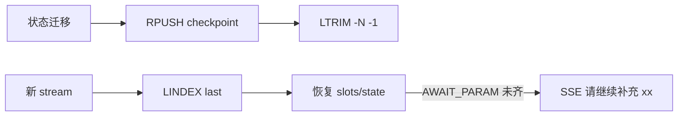

# A3 对话检查点与断点续传实现方案

> **类别**: A | **优先级**: P3 | **状态**: ✅ 已完成（2026-09-04）  
> **关联**: `docs/01-模块设计/P1-核心能力/T3-意图识别与对话管理/04-对话状态机与记忆管理.md` Memento 设计  
> **依赖**: B7 状态机若启用，检查点应含当前 State（本期已落地领域枚举 `AgentPhase`，B7 可直接复用）

## 1. 现状与缺口

设计要求 Redis 每会话最多 5 个 checkpoint，中断可恢复。代码无 `ConversationCheckpoint`。

## 2. 解决什么场景

用户在槽位补全或任务执行中途刷新/断线，恢复后不必从头描述。

## 3. 为什么这样设计

- 检查点是 **会话级快照**，不是消息表替代；消息仍落 MySQL。  
- 只存：state、intent、已填槽位、executionId、stepIndex。不存完整 LLM 上下文（已有 SessionMemory）。  
- Redis List + LTRIM 5，TTL 与会话记忆对齐（`SessionConfig`）。  
- Store 端口 + 恢复处理器 SPI，B7 / 新模式只需 `recordTransition` 或新增 Handler，不必改 Redis 细节。

## 4. 技术栈

Redis + Jackson；Domain 值对象 `ConversationCheckpoint` / `AgentPhase` / `SlotCollection`；`CheckpointService` 在 application。

## 5. 实现方案

1. VO：`checkpointId, conversationId, state, intentCode, slotsJson, executionId, stepIndex, createdAt`。  
2. `ConversationCheckpointStore.save/loadLatest/clear`，key `ckpt:{tenantId}:{conversationId}`。  
3. 合法相位迁移后 `CheckpointService.recordTransition`；stream 入口 `attachLatest`，state 可续传时注入上下文。  
4. 会话 CLOSED/ARCHIVED（事件）以及逻辑删除时 `clear`。  
5. 反序列化失败：打 warn，跳过坏条目；全部失败则从 INIT 开始。

### 落地类

| 层 | 类 | 职责 |
|----|----|------|
| Domain | `AgentPhase` | INIT / AWAIT_PARAM / EXECUTING / CONFIRMATION / DONE / ERROR，与 `ConversationStatus` 正交 |
| Domain | `SlotCollection` | 槽位规格 + 已填值，`fillNext` / `continuePrompt` |
| Domain | `ConversationCheckpointStore` | 存储端口 |
| Infra | `RedisConversationCheckpointStore` | RPUSH + LTRIM 最近 N 条 |
| Application | `CheckpointService` | 写入 / 恢复 / 清理 |
| Application | `CheckpointRestoreHandler` | 按相位扩展恢复逻辑（已实现 AWAIT_PARAM） |
| Application | `SlotAskSupport` | SSE「请继续补充 xx」 |

## 6. 流程图

> RPUSH 后最新在右侧，必须 `LTRIM -N -1`；若 `LTRIM 0 N-1` 会裁掉最新检查点。

## 7. 验收标准

- 断线后新请求能带出未完成槽位，SSE 提问「请继续补充 xx」。  
- 最多 5 条（`SessionConfig.checkpointMaxCount`），旧的被裁掉。  
- CLOSED / ARCHIVED / 删除会话会清理检查点。

## 8. 风险

B7 未做时，对话缺槽与任务相位仍会写检查点，价值已可独立验收。不要在每次 token 上写 Redis（仅相位迁移时写入）。
