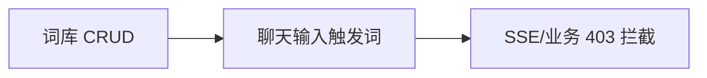

# A1-10 敏感词库管理（前端）

> **类别**: A | **优先级**: P1  
> **来源已办**: B1（围栏已挂对话流；管理 UI 无）  
> **关联**: `SecurityFenceController` `/api/v1/security/sensitive-words/*`  
> **依赖**: `/admin` 壳

## 1. 现状与缺口

敏感词 CRUD/启停仅能走 API；对话已 filterInput，运营改词库无界面。

## 2. 解决什么场景

增删改敏感词、调严重级别与匹配类型，保存后新对话立即按围栏拦截。

## 3. 为什么这样设计

本项只做 **词库配置闭环**；事件审计见 A1-11。配完可在聊天输入触发词验收 B1。

## 4. 技术栈

antd Table + Modal；权限 `security:read` / `security:write`。

## 5. 实现方案

1. 路由 `/admin/security/words`。  
2. 列表：词、类型（精确/正则/模糊）、级别、状态。  
3. 创建/更新/启停/删除对齐后端字段。  
4. 正则非法时展示后端校验错误。

## 6. 流程图

## 7. 验收标准

- 新增精确词并启用后，聊天发送该词被拦截。  
- 停用后同一词可发送。  
- 无 `security:write` 仅可浏览。

## 8. 风险

正则 ReDoS：前端不做引擎，只做长度提示；以后端校验为准。
