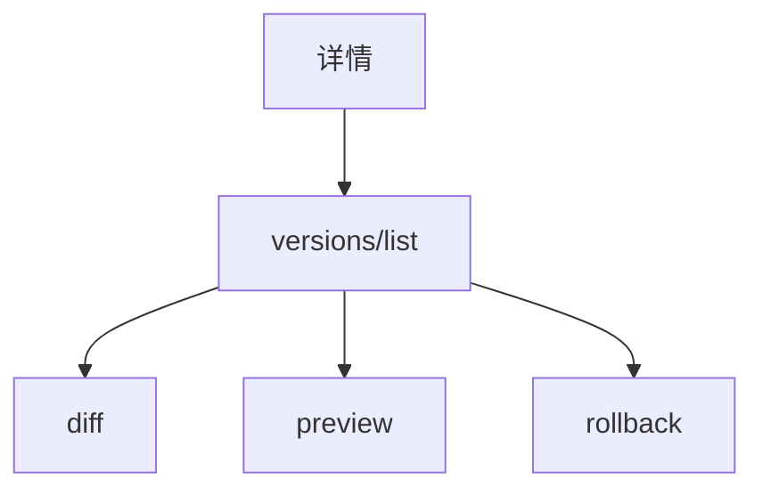

# A1-06 提示词版本对比与回滚（前端）

> **类别**: A | **优先级**: P1  
> **来源已办**: B4 / B12  
> **关联**: `POST /prompts/versions/*`、`/diff`、`/preview`、`/rollback`、`/render`  
> **依赖**: A1-05（列表入口与模板 ID）

## 1. 现状与缺口

版本 API 齐全；无详情页做 diff、预览渲染、回滚。

## 2. 解决什么场景

误发提示词后一键回滚；发布前用变量上下文预览最终渲染结果。

## 3. 为什么这样设计

- 详情路由 `/admin/prompts/:id`，与列表拆分，单次交付可测完整版本闭环。  
- diff/preview 走后端，前端不做本地 diff 算法。

## 4. 技术栈

同 A1-05；版本表 + 双栏 diff 展示（antd Typography / 简单 pre）。

## 5. 实现方案

1. 从 A1-05 行点击进入详情。  
2. 版本列表 + 选两版本调 `/diff`。  
3. 「预览」：填变量 JSON → `/preview` 或 `/render`。  
4. 「回滚到此版本」→ `/rollback` → 刷新列表状态。  
5. 权限：读看 diff；写才能回滚。

## 6. 流程图

## 7. 验收标准

- 任意两版本 diff 有增删高亮或等价可读展示。  
- 回滚后列表最新 PUBLISHED 内容与所选版本一致。  
- 预览失败（缺变量）展示后端错误信息，不白屏。

## 8. 风险

无 A1-05 时本页无入口；联调可用直接 URL + 已知 templateId。
