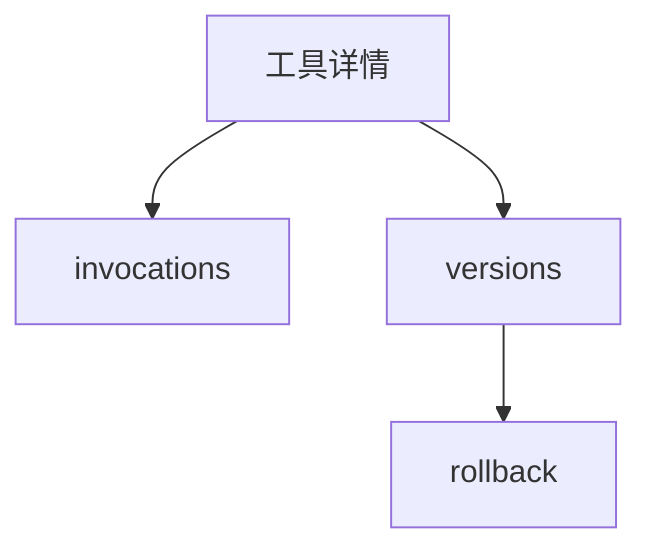

# A1-08 工具调用日志与版本回滚（前端）

> **类别**: A | **优先级**: P2  
> **来源已办**: B5  
> **关联**: `/tools/invocations`、`/versions/list|detail`、`/rollback`  
> **依赖**: A1-07（工具详情入口）

## 1. 现状与缺口

调用日志与版本 API 已有；无运营排障与回滚 UI。

## 2. 解决什么场景

对话调工具失败时查最近 invocation；错误配置发布后回滚到上一版本。

## 3. 为什么这样设计

挂在工具详情 `/admin/tools/:toolId` 的 Tab：**调用日志 | 版本**，与列表页职责分离，本项可单独验收。

## 4. 技术栈

同 A1-07；日志表分页；版本表操作按钮。

## 5. 实现方案

1. 详情页拉取 tool get + invocations（可按时间筛选）。  
2. 日志列：时间、conversationId、成功/失败、耗时、错误摘要。  
3. 版本 Tab：list → detail；rollback 二次确认。  
4. 权限：读日志；写才能回滚。

## 6. 流程图

## 7. 验收标准

- 对话触发一次工具调用后，日志页 1 分钟内可见对应记录。  
- 回滚后 get 返回的配置与目标版本一致。  
- 无工具 ID 时 404/空态友好。

## 8. 风险

日志量大时必须分页；默认只拉最近 50 条。
