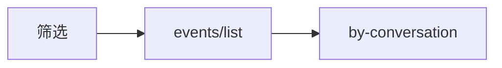

# A1-11 安全事件审计页（前端）

> **类别**: A | **优先级**: P2  
> **来源已办**: B1  
> **关联**: `/api/v1/security/events/list`、`/events/by-conversation`  
> **依赖**: A1-10 可先独立；有拦截数据更易验收

## 1. 现状与缺口

拦截事件可查 API；无审计列表，无法按会话排查谁被拦、何原因。

## 2. 解决什么场景

安全运营按时间/会话查看围栏命中记录，支持客诉核对。

## 3. 为什么这样设计

只读审计页，与词库写配置分离，权限可只授 `security:read`。

## 4. 技术栈

antd Table + RangePicker；可选跳转聊天（有 conversationId 时）。

## 5. 实现方案

1. 路由 `/admin/security/events`。  
2. 筛选：时间范围、conversationId。  
3. 列：时间、用户、会话、规则/原因、动作。  
4. 「按会话」走 `by-conversation`。

## 6. 流程图

## 7. 验收标准

- A1-10 触发一次拦截后，本页能查到对应事件。  
- 无数据时空态，不报错。  
- 无写操作按钮。

## 8. 风险

事件字段以后端 DTO 为准；缺字段时先展示原始 JSON 折叠区。
