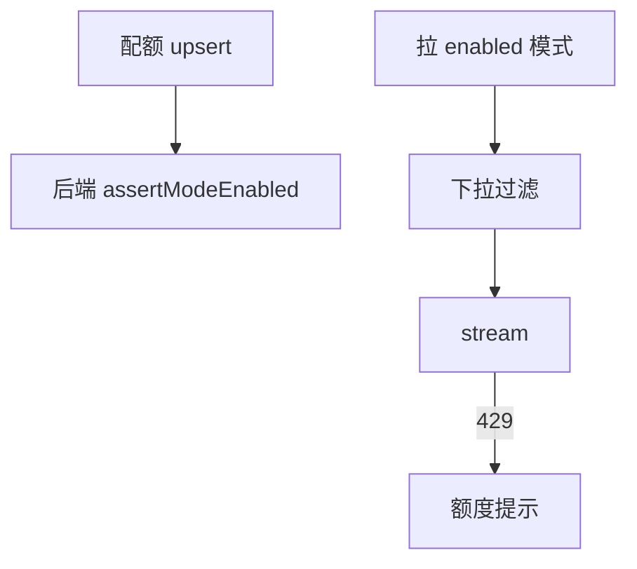

# A1-12 租户模式配额与聊天下拉过滤（前端）

> **类别**: A | **优先级**: P2  
> **来源已办**: A2-04（`TenantModeQuotaController` + QuotaGuard 已生效；前端未接）  
> **关联**: `/api/v1/tenants/mode-quotas`；聊天 `ChatHeader` 模式 Select  
> **依赖**: 登录鉴权；A2-04 后端

## 1. 现状与缺口

配额 upsert/list 仅 API；聊天模式写死五个选项，未按租户 `enabled` 过滤；超限 429 无友好提示。

## 2. 解决什么场景

平台管理员按租户开关模式、设日 LLM 限额；终端用户下拉只看见已开通模式。

## 3. 为什么这样设计

管理页 + 聊天下拉 **同一事项验收**，才能闭环 A2-04 验收句：「关闭后下拉不再展示」。拆开则任一侧单独无法证明产品闭环。

## 4. 技术栈

admin 页 + 改造 `ChatHeader.jsx`；权限 `tenant:write`（管理）/ 聊天侧登录即可读可用模式。

## 5. 实现方案

1. `/admin/tenants/quotas`：按租户 list，表格编辑 enabled、daily_llm_limit、daily_upload_bytes → upsert。  
2. 聊天：启动或进页拉取「当前租户已启用模式」（优先 `GET /interactions/modes` 若已按配额过滤；否则 list quotas 前端滤）。  
3. Select options 仅 enabled；当前 mode 被关则回退 CONVERSATION。  
4. stream 返回 429 时 Composer/全局 toast「今日额度已用完」。

## 6. 流程图

## 7. 验收标准

- 关闭 `KNOWLEDGE_SEARCH` 后，该租户聊天下拉无此项；强行请求应 403/业务错误。  
- 改日限额后超限出现 429 友好提示。  
- 无 `tenant:write` 看不到配额菜单。

## 8. 风险

若 modes 接口未过滤，前端过滤仅为体验；安全仍以后端 Guard 为准——验收必须含直接 API 调用。
