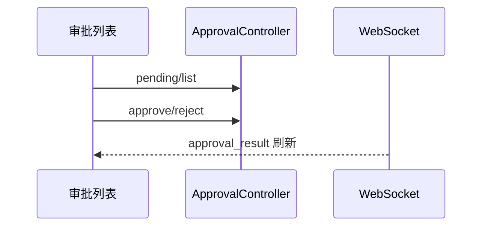

# A1-16 审批中心列表页（前端）

> **类别**: A | **优先级**: P2  
> **来源已办**: A1-02 / B6 / A2-03（聊天卡片与后端闭环已有；无独立审批台）  
> **关联**: `ApprovalController` list/pending/approve/reject/stats；`06-前端功能.md` §11  
> **依赖**: A1-02 卡片组件可复用

## 1. 现状与缺口

仅聊天内 `ApprovalCard`；审批人无法在列表里看待办/已办/我发起并批量处理。

## 2. 解决什么场景

打开 `/admin/approvals`（或 `/approvals`）处理积压工单，不依赖当时是否在对话页。

## 3. 为什么这样设计

列表与卡片共享 `approve/reject` API；WS 推送时刷新列表，与 A1-02 事件模型一致。

## 4. 技术栈

antd Tabs + Table；复用 ApprovalCard 或行内操作；权限 `approval:read` / `approval:write`。

## 5. 实现方案

1. 路由与菜单「审批中心」。  
2. Tab：待办（pending）、全部 list、统计 stats。  
3. 行操作同意/拒绝（原因）；成功后刷新。  
4. 可选：监听已有 WS，收到 `approval_card`/`approval_result` 刷新。

## 6. 流程图

## 7. 验收标准

- 高风险工具触发建单后，待办 Tab 可见并可同意/拒绝。  
- 无 `approval:write` 不能操作。  
- 与聊天卡片操作同一单状态一致。

## 8. 风险

WS 未连时仍可用手动刷新；不要把本项做成强依赖 WS。
