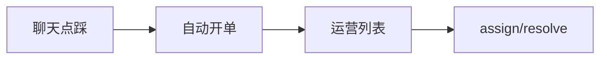

# A1-14 优化工单运营前端

> **类别**: A | **优先级**: P2  
> **来源已办**: A1-03（点踩可开 BadCase 工单；无运营处理页）  
> **关联**: `OptimizationTicketController`；`06-前端功能.md` §10  
> **依赖**: 聊天反馈可用；统计看板见 A1-15 / E2

## 1. 现状与缺口

点踩可自动开单，但无列表/指派/改状态/填写解决说明，闭环停在「入库」。

## 2. 解决什么场景

运营认领工单、改状态、写解决说明，完成 BadCase 人工闭环。

## 3. 为什么这样设计

工单 CRUD 与反馈统计拆开：本项不依赖 E2 路径对齐即可验收处理流。

## 4. 技术栈

`/admin/optimization` 列表 + `/admin/optimization/:id` 详情；权限 `optimization:read` / `optimization:write`。

## 5. 实现方案

1. 列表：状态筛选、分页 list。  
2. 详情：get；操作 assign / update-status / resolve。  
3. 展示关联 messageId/conversationId（可链到聊天若可行）。  
4. 菜单「优化工单」。

## 6. 流程图

## 7. 验收标准

- 聊天点踩后列表出现新单（事件开启前提下）。  
- 指派与 resolve 后状态正确，刷新保持。  
- 无写权限只能看。

## 8. 风险

若 BadCase 监听关闭，可用 API 手工造单验收 UI。
