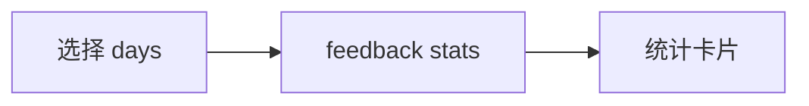

# A1-15 反馈统计看板（前端）

> **类别**: A | **优先级**: P2  
> **来源已办**: A1-03（方案写明运营页对接统计）；契约债见 **E2**  
> **关联**: 设计 `GET /api/v1/feedback/stats`；现状 POST optimization-tickets 路径  
> **依赖**: **建议先完成 E2**；否则本页先对接现网 POST 并标注技术债

## 1. 现状与缺口

无 FeedbackStats 页；即使有 POST 统计接口，前端未调用。

## 2. 解决什么场景

按近 N 天查看赞踩分布，支撑运营例会。

## 3. 为什么这样设计

独立看板页，不塞进工单详情；图表可用简单 Statistic/Progress，不必强上 charts 依赖。

## 4. 技术栈

`/admin/feedback-stats`；E2 完成后改 GET；权限 `optimization:read`。

## 5. 实现方案

1. days 选择（7/30）→ 调统计 API。  
2. 展示总数、LIKE/DISLIKE、可选原因分布。  
3. 入口：管理菜单或工单页顶栏链接。  
4. E2 合并后切换到 GET，删兼容分支。

## 6. 流程图

## 7. 验收标准

- 有反馈数据时数字非全 0；无数据展示 0 而非 404。  
- E2 完成后改 GET 仍通过同一验收。

## 8. 风险

E2 未做时双路径文档易漂移——页头注释写清当前调用的 URL。
