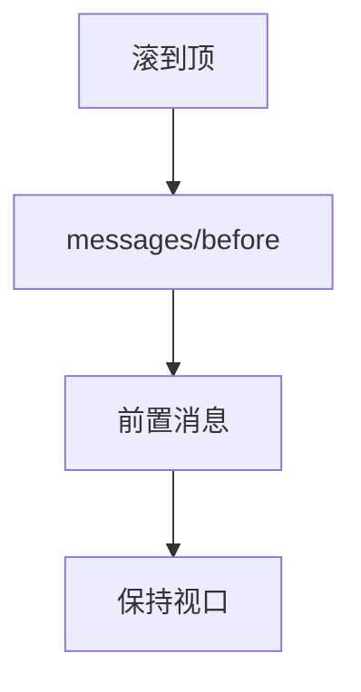

# A1-17 聊天历史消息上翻（前端）

> **类别**: A | **优先级**: P2  
> **来源已办**: A1-01（会话与历史首屏有；`messages/before` 未接）  
> **关联**: `前后端对齐完整度.md` 契约债「消息上翻」  
> **依赖**: 现有 Chat 页与消息列表 API

## 1. 现状与缺口

长会话只拉一页历史；后端已有 `messages/before`，滚到顶无法继续加载。

## 2. 解决什么场景

用户上滑查看更早上下文，反馈与审批仍挂在真实 messageId 上。

## 3. 为什么这样设计

单项闭环：只补历史分页，不改 SSE 发送路径。

## 4. 技术栈

`MessageList` 顶部分页；保留或接入虚拟列表时注意锚点不跳动。

## 5. 实现方案

1. 确认后端 before 参数（messageId/cursor/limit）。  
2. 滚到顶或点「加载更早」→ 请求 before → **前置**插入消息。  
3. 保持滚动位置（记录旧 scrollHeight）。  
4. 无更多时隐藏入口。

## 6. 流程图

## 7. 验收标准

- 超过一页的会话可连续加载直至最早消息。  
- 加载过程中不误触发发送、不丢当前流式气泡。  
- 重复点击不产生重复消息。

## 8. 风险

流式进行中禁止上翻或并发加锁，避免列表错乱。
