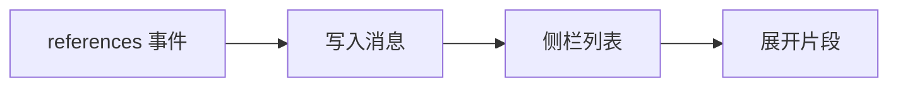

# A1-18 RAG 引用侧栏（前端）

> **类别**: A | **优先级**: P2  
> **来源已办**: A1-01（知识检索模式可用；SSE `references` 仅弱展示）  
> **关联**: `前后端对齐完整度.md`「RAG 引用侧栏」  
> **依赖**: 知识检索 SSE 已下发 references

## 1. 现状与缺口

引用可能只在气泡文案一带而过；用户无法在侧栏点开片段、核对来源文档。

## 2. 解决什么场景

知识检索答完后，侧栏列出引用 chunk/文档名，支持展开原文片段，提升可信度。

## 3. 为什么这样设计

不改后端检索；只消费已有 SSE/消息字段做 UI 闭环。无 references 时侧栏空态即可。

## 4. 技术栈

Chat 布局右侧 Drawer/Sider；点击引用可高亮对应助手消息。

## 5. 实现方案

1. 解析 `references` 事件或 done 载荷，写入当前助手消息。  
2. 侧栏列表：文档名、分数、片段摘要。  
3. 历史消息若 DTO 带引用则回放；无则仅本次会话流式。  
4. 非知识检索模式隐藏侧栏。

## 6. 流程图

## 7. 验收标准

- 知识检索有命中时侧栏至少 1 条引用（数据足够时）。  
- 无命中空态文案，不报错。  
- 切换会话清空侧栏。

## 8. 风险

字段名与结构需与后端 DTO 核对；不一致时本项含一次契约对齐（仅文档+前端类型，不改检索算法）。
